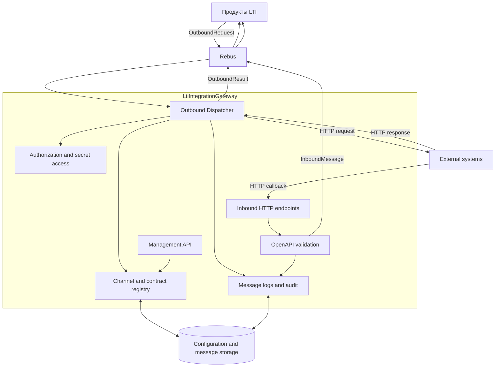

# Архитектура LtiIntegrationGateway

Документ фиксирует **архитектурный контекст, границы ответственности, принципы и ограничения**
`LtiIntegrationGateway`, а также фактическую организацию кода, инфраструктурные компоненты и
потоки выполнения. Это актуальное описание системы, а не журнал истории решений.

## Источники истины и границы документации

- `openspec/specs/` — актуальные функциональные и системные требования, наблюдаемое поведение
  и проверяемые сценарии.
- `ARCHITECTURE.md` — архитектурные границы, принципы, технические ограничения, взаимодействия
  компонентов и фактическая реализация этих принципов.
- `src/LtiIntegrationGateway/Protos/` — исходные контракты gRPC/REST и сообщений Rebus.
- `README.md` — обзор репозитория, команды сборки, запуска и настройки.
- `AGENTS.md` — правила разработки и обязательного документирования контрактов.
- `openspec/changes/archive/` — история изменений, включая исходные причины, проектирование и
  задачи реализации.

OpenSpec Specs описывают, **что система должна делать**. Этот документ описывает, **какие
архитектурные границы и механизмы приняты и как система устроена сейчас**. Детальные сценарии
возможностей не дублируются здесь, если они уже описаны в соответствующих Specs.

**Актуальность.** Фактическое состояние кода проверяется и обновляется после архивации OpenSpec
Change, если изменение затронуло компоненты, структуру, взаимодействия, контракты или архитектурные
ограничения. История изменений не копируется в этот файл: её источником является OpenSpec Archive.

## 0. Архитектурный контекст и принципы

### 0.1. Назначение и границы ответственности

`LtiIntegrationGateway` — самостоятельное приложение, обеспечивающее интеграцию продуктов LTI с
внешними системами по HTTP API. Шлюз централизует транспортные механизмы интеграции, каналы,
аутентификацию, валидацию входящих контрактов, маршрутизацию сообщений, повторные попытки,
сохранение результатов и аудит.

**Продукты владеют бизнес-смыслом интеграции.** Продукт выбирает бизнес-операцию, знает структуру
внешнего API, формирует данные исходящего запроса и интерпретирует ответ внешней системы. Шлюз не
выполняет бизнес-маппинг и не принимает бизнес-решения на основании содержимого HTTP-ответа.

Граница взаимодействия:

- бизнес-данные и результаты интеграционных операций между продуктами и шлюзом передаются через
  Rebus;
- продукты не используют REST/gRPC управляющего API для отправки бизнес-запросов или получения
  результатов интеграции;
- gRPC и REST (через JSON transcoding) используются для управления каналами, маршрутами,
  контрактами и конфигурацией, а также для диагностических операций;
- входящие HTTP-вызовы от внешних систем принимаются шлюзом и передаются целевому продукту через
  Rebus.

Исходящий и входящий контуры независимы и имеют раздельные модели каналов: `OutboundChannel` и
`InboundChannel`. Единый двунаправленный канал не используется.

### 0.2. Контекст взаимодействия



### 0.3. Стиль приложения и организация кода

Приложение реализовано как модульный монолит с разделением по функциональным областям:

- весь производственный код находится в `LtiIntegrationGateway`;
- автоматические тесты находятся в отдельном `LtiIntegrationGateway.Tests`;
- функциональность организована по Feature-first и Vertical Slice Architecture;
- вертикальный срез содержит сценарий и необходимые ему проверки, работу с данными и результат;
- общие инфраструктурные компоненты располагаются в `Infrastructure`;
- универсальные репозитории, медиаторы и абстракции не вводятся без конкретной необходимости;
- производственный код шлюза не зависит от сборок конкретных продуктов.

### 0.4. Контрактный подход и совместимость

Protobuf используется как contract-first формат для gRPC API и сообщений, передаваемых через Rebus.
Файлы `.proto` являются исходным определением транспортных контрактов; C#-типы генерируются
через `Grpc.Tools` и не поддерживаются вручную как параллельные DTO.

Контракты не зависят от EF Core-сущностей, внутренней модели хранения или бизнес-моделей продуктов.
Опубликованные `.proto` распространяются как исходные файлы из репозитория; потребители фиксируют
используемую версию по тегу или коммиту.

Правила совместимости:

- внутри версии допускаются совместимые добавочные изменения;
- несовместимое изменение оформляется новой версией protobuf package, а шлюз на переходном этапе
  может обрабатывать несколько версий параллельно;
- номер поля не переиспользуется; удалённые номера и имена помечаются `reserved`;
- смысл существующего поля не меняется в рамках той же версии;
- нулевое значение enum именуется `*_UNSPECIFIED`; для скалярных полей, где важно различать
  отсутствие и значение по умолчанию, используется `optional`;
- `google.protobuf.Any` не используется в интеграционных сообщениях; тела запросов и ответов
  передаются как `bytes`.

Сериализация сообщений Rebus использует ProtoJSON (UTF-8) через собственный `ISerializer`:

| Элемент | Правило |
|---|---|
| Формат тела | ProtoJSON, UTF-8 |
| Печать | `JsonFormatter.Default`; имена camelCase, enum — строковыми именами, `bytes` — base64 |
| Разбор | `JsonParser` с `IgnoreUnknownFields = true`; поддерживаются camelCase и snake_case |
| Неизвестное имя enum | ошибка разбора; неизвестное числовое значение enum сохраняется |
| 64-битные целые | строковое представление по правилам ProtoJSON |
| `rbs2-msg-type` | полное protobuf-имя сообщения |
| `rbs2-content-type` | `application/json` |

### 0.5. Статические и динамические HTTP endpoint

Управляющие gRPC-сервисы публикуются также как REST endpoint через JSON transcoding. Эти маршруты
определены статическими Protobuf-контрактами приложения.

Inbound endpoint-ы формируются динамически из опубликованных OpenAPI-контрактов. Для них используется
кастомный `EndpointDataSource`, подключённый к `IEndpointRouteBuilder.DataSources`. При активации
ревизии каталог маршрутов обновляется без пересборки и перезапуска приложения.

Публикация набора маршрутов отклоняется, если в активной конфигурации есть конфликтующие пары
«HTTP-метод + шаблон». Пересекающиеся, но не конфликтующие шаблоны сопоставляются штатным механизмом
приоритета ASP.NET Core. Поведение динамического добавления/удаления маршрутов и применения rate limit
покрыто интеграционными тестами.

JSON transcoding не используется для публикации динамических маршрутов из загруженного OpenAPI:
это отдельный runtime-механизм ASP.NET Core.

### 0.6. Жизненный цикл конфигурации

Каналы и OpenAPI-контракты изменяются через версионируемые конфигурации:

1. создаётся или изменяется черновик;
2. конфигурация проверяется;
3. валидная конфигурация публикуется как неизменяемая ревизия;
4. ревизия активируется;
5. при необходимости выполняется откат к предыдущей ревизии.

Runtime использует согласованные снимки конфигурации. Запрос обрабатывается в рамках той ревизии,
с которой он был начат. Изменения каналов, контрактов и маршрутов применяются без перезапуска.
Изменение секретов, поступающих через переменные окружения, требует перезапуска процесса, поскольку
источники конфигурации .NET не перечитываются автоматически.

### 0.7. Безопасность и надёжность: архитектурные ограничения

- Значения секретов не хранятся в БД и не передаются в сообщениях Rebus, результатах API или логах.
  В конфигурации хранятся тип авторизации, ключ конфигурации и несекретные параметры; секреты
  читаются через `ISecretStore` из конфигурации окружения.
- Проверка отсутствующих секретов активной конфигурации выполняется при старте приложения; отсутствие
  необходимого секрета приводит к fail-fast отказу запуска.
- Для исходящих HTTP-вызовов базовый URL берётся из конфигурации канала; путь запроса является
  относительным и структурно проверяется до отправки. Автоматические редиректы отключены.
- Проверка серверного TLS-сертификата не отключается; минимальная версия TLS — 1.2.
- Клиентские сертификаты учитываются при выделении HTTP handler pool: соединения не разделяются
  между конфигурациями с разными сертификатами.
- HTTP-повторы определяются транспортной ошибкой и HTTP-статусом, а не бизнес-содержимым тела
  ответа. Для потенциально небезопасных `POST`/`PATCH` повтор допустим только при наличии
  `idempotency_key`.
- Гарантия доставки результата — «минимум один раз», а не exactly-once. Получатель должен
  учитывать возможную повторную доставку и выполнять дедупликацию по `message_id`.
- Исходящий результат сохраняется до попытки отправки и может быть повторно доставлен фоновым
  диспетчером.
- Текущий транспорт Rebus — in-memory: сообщения в очереди не переживают остановку или аварию
  процесса. Такой транспорт подходит для начального этапа и тестирования, но не обеспечивает
  промышленную надёжную доставку. Для входящего контура гарантия доставки также зависит от
  настроенного транспорта Rebus.

### 0.8. Поддержка OpenAPI

Для входящих контрактов используется целевой формат OpenAPI 3.0. Документы Swagger 2.0
конвертируются при загрузке; OpenAPI 3.1 не принимается текущей реализацией.

Проверка документа выполняется при публикации и работает по принципу fail-closed:

- поддерживается закрытый перечень конструкций OpenAPI 3.0;
- разрешены только локальные `$ref`; внешние HTTP(S), `file`, protocol-relative и относительные
  ссылки запрещены;
- `$ref` с соседними полями отклоняется;
- конфликты маршрутов и проблемы контракта обнаруживаются до активации;
- схемы запросов компилируются для активной ревизии и используются повторно при обработке запросов.

Поддерживаемые конструкции и конкретные правила валидации отражаются в OpenSpec spec
`contract-registry` и связанных спеках входящего контура.

## 1. Состав решения

| Элемент | Назначение |
|---|---|
| `LtiIntegrationGateway.slnx` | решение; оба проекта подключены |
| `src/LtiIntegrationGateway` | весь производственный код (`Microsoft.NET.Sdk.Web`, `net10.0`) |
| `src/LtiIntegrationGateway.Tests` | тесты на TUnit (`Microsoft.Testing.Platform`) |
| `global.json` | включает runner MTP для `dotnet test` на .NET 10 |

Ключевые пакеты производственного проекта: `Google.Protobuf`, `Grpc.Tools` (генерация из `.proto`),
`Grpc.AspNetCore` + `Microsoft.AspNetCore.Grpc.JsonTranscoding` (gRPC и REST из одного контракта),
`Microsoft.EntityFrameworkCore.Sqlite` + `Design`, `Microsoft.OpenApi` (чтение контрактов),
`Rebus` + `Rebus.ServiceProvider`.

Тестовый проект дополнительно использует `Microsoft.AspNetCore.Mvc.Testing`, `Grpc.Net.Client`.

## 2. Точка сборки приложения

`Program.cs` — единственная композиционная точка; порядок регистрации значим.

| Шаг | Что делает |
|---|---|
| `AddDbContext<GatewayDbContext>` | SQLite по `ConnectionStrings:Gateway`, без строки — исключение |
| `AddGatewayObservability`, `AddHealthChecks`, `AddGatewayRebus` | OTel traces/metrics, readiness-проверка хранилища и шина с ProtoJSON-сериализатором |
| Регистрация срезов `Features/Channels` | валидатор и шесть сценариев жизненного цикла |
| Регистрация outbound-шагов | `ISecretStore`, маршруты продуктов, шаги проверки и вызова; `StoredOutboundResultFactory` восстанавливает результат для повтора и диспетчера |
| Регистрация диспетчера результатов | `Configure<OutboundDeliveryOptions>` и `AddHostedService<OutboundResultDispatcher>`; параметры — ключи `Outbound:DeliveryDispatcher` |
| Регистрация инфраструктуры исходящих вызовов | пул `ChannelHttpClientPool` (`IChannelHttpClientFactory`) и `IChannelCertificateStore`; `AllowAutoRedirect = false`, TLS 1.2+ (см. раздел 0.7) |
| Каталог входящих маршрутов и источник endpoint'ов | синглтоны `InboundRouteCatalog`, `InboundEndpointDataSource` |
| `AddRateLimiter` | политика `inbound-per-channel`, `429` при превышении |
| Контракты и управляющий API | reader OpenAPI, четыре среза контрактов, `ManagementApiService` |
| `AddGrpc().AddJsonTranscoding()` | публикация управляющего сервиса как gRPC и REST |
| Fail-fast проверка строки подключения | выполняется **после** `builder.Build()` |
| `Database.Migrate()` | миграции применяются при старте |
| `UseRateLimiter`, `UseMiddleware<ManagementApiKeyMiddleware>` | ограничение частоты и ключ API |
| `((IEndpointRouteBuilder)app).DataSources.Add(...)` | динамические маршруты: регистрации в DI недостаточно |
| `MapGrpcService<ManagementApiService>`, `MapHealthChecks` | управляющий сервис, `/health/live` и `/health/ready` |

Инварианты: fail-fast проверка конфигурации — после `Build()` (иначе тестовые переопределения не
видны); миграции применяются автоматически; `/health/live` не требует ключа управляющего API, а
`/health/ready` проверяет только доступность хранилища.

`AddGatewayObservability` — единственная точка подключения OTel: она читает `Observability:Otel`,
создаёт OTLP-экспортёры traces/metrics и регистрирует `GatewayMetrics`; при включённой
телеметрии также регистрируется `OutboundBacklogMetricsUpdater`. Rebus-диагностика включается в
`Infrastructure/Rebus/RebusConfigurationExtensions` через `EnableDiagnosticSources`, а
`AddRebusInstrumentation` в OTel builder связывает её spans и метрики с общим pipeline.

## 3. Карта каталогов

| Каталог | Содержимое | Где описано |
|---|---|---|
| `Protos/v1` | интеграционные сообщения `lti.gateway.messages.v1` и управляющий API `lti.gateway.management.v1` | контракты `Protos/v1` и OpenSpec Specs |
| `Protos/google/api` | вендорные `annotations.proto` и `http.proto` для HTTP-аннотаций; не редактируются, C#-типы берутся из `Google.Api.CommonProtos` | раздел 0.5 |
| `Contracts` | `MessageContractValidator` — проверка обязательных полей `OutboundRequest` | spec `message-contracts` |
| `Features/Channels` | канал и его ревизии: создание, черновик, публикация, активация, откат, чтение | spec `channel-registry` |
| `Features/ProductRoutes` | маршруты продуктов: разрешённые каналы и вычисленный адрес очереди `<product_id>.inbox` | spec `outbound-dispatch` |
| `Features/Outbound` | обработка `OutboundRequest`: проверки, авторизация, HTTP с повторами, операция и журнал, публикация результата, восстановление сохранённого результата, фоновый диспетчер доставки | spec `outbound-dispatch` |
| `Features/Contracts` | версии OpenAPI-контрактов: загрузка, публикация со схемами тела и переносом настроек операций, настройки приёма и настройки операции, активация, чтение версии и операций | spec `contract-registry`, `management-api` |
| `Features/Inbound` | приём входящего вызова: проверки, аутентификация, публикация `InboundMessage`, журнал, отказ отключённой операции | spec `inbound-dispatch`, `inbound-routing` |
| `Features/Management` | gRPC-фасад управляющего API и маппинг proto ↔ домен | spec `management-api` |
| `Infrastructure/Persistence` | `GatewayDbContext`, сущности, миграции | раздел 5 |
| `Infrastructure/Rebus` | `ProtobufSerializer`, `ProtobufMessageRegistry`, конфигурация шины | разделы 0.4 и 6 |
| `Infrastructure/OpenApi` | чтение документа, fail-closed проверки, извлечение и кэширование схем тела | раздел 0.8 |
| `Infrastructure/Routing` | каталог маршрутов, источник endpoint'ов, валидатор набора, метаданные маршрута, лимит частоты | раздел 0.5 и spec `inbound-dispatch` |
| `Infrastructure/Http` | `ChannelHttpClientKey`, `ChannelHttpClientPool` (`IChannelHttpClientFactory`), аренда обработчика: пул соединений по ключу канала | раздел 0.7 |
| `Infrastructure/Security` | `ISecretStore`, `IChannelCertificateStore` и реализации поверх `IConfiguration`; кэш клиентских сертификатов на время жизни процесса | раздел 0.7 |
| `Infrastructure/Management` | ключ управляющего API, аудит управляющих операций | раздел 8 |
| `Infrastructure/Observability` | OTel-настройки, `GatewayTelemetry`, `GatewayMetrics`, backlog-gauge и OTLP-экспорт | раздел 8 |
| `Infrastructure/Health` | `DatabaseHealthCheck` для `GET /health/ready` | раздел 8 |

`bin`, `obj`, `Properties` — служебные, в архитектуре не участвуют.

## 4. Вертикальные срезы

Каждый сценарий — отдельный каталог с командой/запросом, результатом и обработчиком; общих
репозиториев и медиатора нет (раздел 0.3).

### Каналы (spec `channel-registry`)

```text
Features/Channels
├── CreateChannel            CreateChannelHandler
├── UpdateChannelDraft       UpdateChannelDraftHandler
├── PublishChannelRevision   PublishChannelRevisionHandler
├── ActivateChannelRevision  ActivateChannelRevisionHandler
├── RollbackChannelRevision  RollbackChannelRevisionHandler
├── GetChannel               GetChannelHandler
├── GetChannelHealth         GetChannelHealthHandler: активная ревизия, секрет, срок сертификата, последние ошибки
├── ChannelConfiguration      настройки ревизии (record)
├── ChannelConfigurationValidator  проверки публикации
├── ChannelRevisionWriter     перенос настроек в сущность и обратно
└── ChannelAuditWriter        аудит изменения в транзакции среза
```

### Маршруты продуктов и исходящий контур (spec `outbound-dispatch`)

```text
Features/ProductRoutes
├── RegisterProductRoute     upsert каналов и вычисленного адреса `<product_id>.inbox`
└── GetProductRoute          чтение маршрута: адрес всегда вычисленный

Features/Outbound
├── OutboundRequestHandler        адаптер Rebus: заголовки → команда
├── ProcessOutboundRequestHandler сценарий: порядок проверок и вызов
├── ResolveSenderIdentityHandler         product_id + rbs2-sender-address по ProductRoutes
├── LoadActiveChannelHandler             активная ревизия канала
├── RelativePathValidator                структурная проверка пути без allow-list
├── ResolveAuthorizationHandler          none / bearer / api_key / basic / client_certificate
├── ExecuteHttpCallHandler               HTTP с повторами по политике канала, обработчик из пула
├── OutboundOperationRecorder     операция и журнал одной транзакцией
├── StoredOutboundResultFactory   восстановление результата из операции и журнала
├── PublishOutboundResultHandler         Send результата и признак доставки
├── OutboundResultDispatcher      фоновая повторная доставка `pending`-записей
├── OutboundDeliveryOptions       параметры диспетчера (включение, интервал, пачка)
└── OutboundErrorCodes            коды отказов и транспортных ошибок

Infrastructure/Http
├── ChannelHttpClientKey      базовый адрес, тип авторизации, отпечаток сертификата
├── ChannelHttpClientPool     SocketsHttpHandler по ключу, TLS 1.2+, без редиректов
└── ChannelHttpClientLease    аренда обработчика на время вызова
```

### Контракты (spec `contract-registry`, `management-api`)

```text
Features/Contracts
├── UploadContractVersion          документ → черновик версии
├── PublishContractVersion         операции, схемы тела, дубли operationId, конфликты, очередь, перенос настроек
├── ActivateContractVersion        каталог маршрутов + кэш схем → транзакция БД
├── ListContractOperations         операции версии с настройками
├── GetContractVersion             версия с настройками и операциями
├── UpdateContractVersionSettings  настройки приёма черновика
├── UpdateContractOperationSettings настройки операции: enabled, очередь; применение без перезапуска
├── ContractVersionSettings        настройки приёма версии (record)
├── ContractOperationSettings      действующие настройки операции: очередь — операция → версия; квота — версия → приложение (record)
└── ContractRouteSets              InboundRouteSet из операций версии с действующими настройками
```

### Хост (spec `gateway-host`)

```text
Features/Host
└── StartupSecretValidator  проверка секретов активных ревизий каналов и версий контрактов при старте
```

### Входящий контур (spec `inbound-dispatch`)

```text
Features/Inbound
├── InboundRequestHandler          проверки, InboundMessage, журнал, 202 async / ответ sync / 504 / 502
├── InboundRequestPath             фактический путь запроса без query и декодирования
├── InboundRequestAuthenticator    none, api_key, basic, client_certificate
├── InboundDisabledOperationHandler 404 без чтения тела и аутентификации + аудит InboundOperationDisabled
├── InboundMessageLogWriter        запись Pending → Sent | Replied | TimedOut | Cancelled | Failed
└── InboundMessagePublisher        IInboundMessagePublisher + Rebus Send / SendRequest

Infrastructure/Routing
├── InboundRouteDefinition     маршрут, настройки операции, режим ответа и timeout
├── InboundRouteCatalog        активные наборы, снапшот, токен изменения
├── InboundRouteSetValidator   методы, шаблоны, конфликты (включая отключённые операции)
├── InboundEndpointDataSource  RouteEndpoint'ы, метаданные маршрута, делегат приёма или отказа
├── InboundChannelMetadata     канал как ключ лимита частоты
├── InboundRouteMetadata       ревизия, операция, очередь, авторизация, квота, mode/timeout
└── InboundRateLimitOptions    квота и окно по умолчанию

Infrastructure/OpenApi
├── InboundSchemaCache         компиляция схем на ревизию, удаление при деактивации
└── OpenApiDocumentValidator   извлечение схем тела с инлайнингом локальных $ref
```

### Управляющий API (spec `management-api`)

```text
Features/Management
├── ManagementApiService              gRPC-фасад: зависимости и общие помощники
├── ManagementApiService.Channels     outbound-каналы и ревизии
├── ManagementApiService.InboundChannels  inbound-каналы, настройки и health
├── ManagementApiService.Catalog      маршруты продуктов, статус операции
├── ManagementApiService.Contracts    версии контрактов inbound-каналов
└── ChannelMapping                    proto ↔ ChannelConfiguration
```

Фасад не содержит доменных правил: он вызывает срезы, отображает результаты в proto-сообщения,
возвращает `NotFound` для отсутствующих объектов и пишет аудит управляющих операций.

## 5. Инфраструктурные компоненты

| Компонент | Ответственность | Особенности |
|---|---|---|
| `Persistence/GatewayDbContext` | модель данных и конфигурация EF Core | уникальные индексы, каскады, конвертация enum и политики повторов в строку/JSON |
| `Persistence/Entities` | outbound/inbound-каналы, ревизии, маршруты продуктов, контракты с настройками приёма, операции со схемами, журналы; папки по логическим областям, все классы реализуют `IEntity`, публичные свойства документированы | опубликованные ревизии и версии контрактов неизменяемы; направления разделены |
| `Persistence/Migrations` | `InitialSchema` — базовая схема с `OutboundChannels`, `InboundChannels` и журналом ответов | применяется при старте; старые dev-миграции удалены |
| `Rebus/ProtobufSerializer` | `ISerializer` на ProtoJSON | заголовки `rbs2-msg-type` и `rbs2-content-type` |
| `Rebus/ProtobufMessageRegistry` | реестр типов сообщений | неизвестный тип — диагностируемая ошибка |
| `Rebus/RebusConfigurationExtensions` | регистрация шины, error-queue и обработчика | входная очередь `lti.gateway.outbound`, error-queue `lti.gateway.error` |
| `OpenApi/MicrosoftOpenApiDocumentReader` | чтение документа, версия, синтаксис | `Microsoft.OpenApi` 3.11.0 (раздел 0.8) |
| `OpenApi/OpenApiDocumentValidator` | fail-closed проверки, извлечение операций и схем тела | запрещённые ключевые слова, `$ref`, `format`; инлайнинг `$ref` до глубины 32 |
| `OpenApi/InboundSchemaCache` | скомпилированные схемы активных ревизий | `NJsonSchema` 11.6.1, компиляция при активации |
| `Management/ManagementApiKeyMiddleware` | ключ управляющего API | `401`/`503`, gRPC `Unauthenticated` |
| `Management/ManagementAuditWriter` | аудит управляющих операций, включая чтение и отказы `NotFound` | без значений секретов; усечение объекта и деталей до длин модели |
| `Features/Host/StartupSecretValidator` | fail-fast проверка секретов активной конфигурации после миграций | активные ревизии каналов и версии контрактов; сообщения содержат только имена ключей |
| `Security/ConfigurationSecretStore` | значение секрета по ключу | только `IConfiguration` |
| `Security/ConfigurationChannelCertificateStore` | клиентский сертификат по `config_key` | PFX из файла или base64, пароль `<config_key>:Password`, кэш на время жизни процесса |
| `Http/ChannelHttpClientPool` | пул `SocketsHttpHandler` по ключу канала | TLS 1.2+, без редиректов, проверка серверного сертификата, срок жизни соединения 5 минут |

Имена очередей сосредоточены в `Rebus/QueueNames` (имена очередей определены в разделе 6): входная очередь
`lti.gateway.outbound`, error-queue `lti.gateway.error` (настраивается `RetryStrategy` с сохранением
значений по умолчанию для числа попыток и кулдауна), очередь продукта вычисляется как
`<product_id>.inbox`. Список `ProductRouteQueueAddress` остаётся в модели для обратной
совместимости чтения, но проверки `rbs2-sender-address` и `rbs2-return-address` идут против
вычисленного адреса; регистрация маршрута принимает пустой список или вычисленный адрес.

## 6. Контракты и генерация кода

- `Protos/v1/integration_messages.proto` — сообщения Rebus (`lti.gateway.messages.v1`):
  `OutboundRequest`, `OutboundResult`, `InboundMessage`, `InboundResponse`, `InboundResponseHeader`,
  `QueryParameter`, `Outcome`. `reply_expected` включает request/reply для sync inbound.
- `Protos/v1/management_api.proto` — управляющий API (`lti.gateway.management.v1`): direction-first
  ресурсы `/v1/outbound-channels` и `/v1/inbound-channels`; состояние отдают RPC
  `GetOutboundChannelHealth` и `GetInboundChannelHealth`; используются `google.protobuf.Timestamp`.
- `Protos/google/api/*.proto` — вендорные дескрипторы; подключаются только как путь импорта,
  C#-типы берутся из `Google.Api.CommonProtos` (иначе конфликт типов CS0436).
- Генерация выполняется при сборке (`Grpc.Tools`); сгенерированные файлы не редактируются и в
  репозитории не хранятся.
- Обязательное требование к документации контрактов — `AGENTS.md`.

## 7. Потоки и транзакционные границы

**Outbound.** `OutboundRequest` → проверки (поля, продукт и вычисленный адрес отправителя
`<product_id>.inbox`, тот же адрес для доставки результата, идемпотентность, активная ревизия
канала, структурная проверка пути, авторизация) → операция `Accepted` → `InProgress` → HTTP-вызов
с повторами →
**одна транзакция**: операция `Completed` + запись журнала
`pending` (с адресом доставки, `correlation_id`, текстом ошибки, номером ревизии канала и
`CreatedAt`) → `Send` результата → журнал `sent`. Отказы, возникшие до проверки адреса возврата,
не доставляются: операция `Completed`, журнал `undeliverable`, адрес пуст. Невалидный DTO
(`FailFastException`) уходит в `lti.gateway.error` без операции, журнала и HTTP-вызова
(spec `outbound-dispatch`).

Недоставленные записи `pending` повторно отправляет `OutboundResultDispatcher`: выборка идёт в SQL по
индексу `(DeliveryStatus, CreatedAt)` с фильтром «адрес не пуст и операция существует», поэтому
недоставляемые записи не занимают пачку; отправка и фиксация статуса обрабатываются по отдельности, а
гарантия остаётся «минимум один раз». Повторный `OutboundRequest` с завершённым `message_id` отдаёт
идентичный сохранённый результат на адрес из текущего сообщения; владение `product_id` проверяется до
выдачи результата, а проверки канала и авторизации для завершённой операции не
повторяются (см. разделы 0.7 и 7; spec `outbound-dispatch`).

**Контракты.** Загрузка создаёт черновик версии; публикация извлекает операции и схемы тела
(локальные `$ref` разворачиваются), требует очередь получателя в настройках версии формата
`<product_id>.inbox` (см. разделы 0.4 и 6),
дополнительно проверяет действующую очередь каждой включённой операции, переносит настройки операций
из предыдущей версии канала (по `operationId`, а при его отсутствии хотя бы у одной из операций — по
совпадению метода и шаблона; изменённый `operationId` при том же маршруте — новая операция) и
проверяет конфликты; активация сначала регистрирует набор в каталоге маршрутов, затем одной
транзакцией меняет статусы версий,
снимает набор предыдущей версии и пересобирает кэш схем; при проблемах каталога база не меняется
(spec `contract-registry`).

**Настройки операции.** Действующие значения вычисляются при построении набора маршрутов
(`ContractRouteSets`): очередь — операция, иначе версия; квота и окно — только версия, иначе
`Inbound:RateLimit:*`; авторизация берётся только из версии. Все операции канала делят один
бюджет ограничения частоты. Операции извлекаются при публикации,
поэтому для черновика настройки операции недоступны (`404`). Изменение настроек версии `Active`
перерегистрирует набор с тем же ключом ревизии: отказ каталога оставляет прежний набор и не меняет
базу; версия `Superseded` отклоняется с проблемой `version` (spec `contract-registry` и `management-api`).

**Входящий контур.** Запрос попадает на динамический endpoint с метаданными маршрута, далее
фиксированный порядок: query (≤ 64) → `Content-Type` по схемам ревизии → наличие схемы тела →
аутентификация по настройкам ревизии → глубина JSON (≤ 64) → валидация по схеме → запись журнала
`pending` → `Send` в очередь получателя → журнал `sent` и `202`. Любой отказ пишется в журнал
`failed` с кодом ошибки; при сбое `Send` ответ `503` (spec `inbound-dispatch`).
Отключённая операция обслуживается отдельным делегатом: тело не читается, аутентификация не
выполняется, в `ManagementAuditEntry` пишется `InboundOperationDisabled`, ответ — `404`.

**Каналы.** Ревизия — агрегат настроек: правки идут в черновик, публикация фиксирует неизменяемую
ревизию, активация делает её действующей, откат возвращает предыдущую (spec `channel-registry`).

**Аудит.** `ChannelAuditEntry` пишется в транзакции доменного среза; `ManagementAuditEntry`
фиксирует факт управляющего вызова, включая отклонённые и читающие операции.

## 8. Соглашения и повторяемые решения

| Решение | Причина |
|---|---|
| Ревизия — агрегат настроек, в `OutboundChannel`/`InboundChannel` настроек нет | неизменяемость опубликованного и безопасный откат |
| Результат операции — запись с `Problems`, а не исключение | отказ домена не является сбоем, список проблем возвращается целиком |
| Операции с одним значением и возможным отказом возвращают `Result<T>` | единая форма `Value`/`ErrorCode`/`ErrorMessage` вместо дублирующихся result-записей |
| Новые дочерние сущности добавляются через `DbSet`, а не только в навигацию | клиентский Guid-ключ: EF считает их `Modified`, `UPDATE` не находит строку |
| Моменты времени журналов хранятся как миллисекунды Unix через EF-конвертер | SQLite не умеет сортировать `DateTimeOffset`; преобразование типа скрыто в модели, а индексы и `ORDER BY` работают по `CreatedAt`/`ReceivedAt` |
| Строковые поля proto заполняются только непустыми значениями | присваивание `null` бросает `ArgumentNullException` |
| Динамические endpoint'ы добавляются в `IEndpointRouteBuilder.DataSources` | регистрации `EndpointDataSource` в DI недостаточно (см. раздел 0.5) |
| gRPC-сервисы публикуются в корне | transcoding сохраняет пути `/v1/...`; следствие — двухсегментные inbound-маршруты отвечают `404` вместо `405` (см. раздел 6) |
| Секреты читаются только через `ISecretStore` | в базе и API хранятся лишь ключи конфигурации |
| Схемы тела компилируются один раз на ревизию | валидация не тратит CPU на каждый запрос (раздел 0.8) |
| Публикация сообщения идёт через `IInboundMessagePublisher` | транспорт изолирован, сбой передачи наблюдаем в тестах |
| Запись журнала `pending` создаётся до `Send` | сбой передачи виден в журнале, а не теряется |
| Сравнение секретов — `CryptographicOperations.FixedTimeEquals` | исключение утечки по времени (см. раздел 0.7) |

## 9. Тесты

Структура повторяет производственные каталоги; общая обвязка — `TestSupport`.

| Каталог | Что проверяется |
|---|---|
| `Contracts` | round-trip ProtoJSON, профиль кодирования, дескрипторы, `MessageContractValidator` |
| `Features/Host` | liveness, конфигурация хранилища, отсутствие демо-API, регистрация обработчиков |
| `Features/Channels` | валидатор настроек, жизненный цикл ревизий, сохранение до `DbContext` |
| `Features/Outbound` | успешный вызов, отказы, авторизация, повторы, идемпотентность, идентичность повтора, диспетчер недоставленных результатов |
| `Features/Inbound` | маршрутизация, приём вызова, аутентификация, коды ответов, журнал, лимит частоты, отключённая операция и аудит |
| `Features/Contracts` | загрузка и проверка документов, публикация, настройки версии, активация маршрутов |
| `Features/Management` | ключ API, паритет gRPC/REST, каналы, маршруты, статус операции |
| `Infrastructure/*` | сериализация и реестр Rebus, `DbContext`, каталог маршрутов, чтение OpenAPI, извлечение и компиляция схем, пул HTTP-обработчиков, хранилище сертификатов |

`TestSupport`:

- `SqliteInMemoryDatabase` — SQLite `:memory:` с открытым соединением на время теста;
- `GatewayWebApplicationFactory` — хост с подменой строки подключения и дополнительными ключами
  конфигурации;
- `OutboundFixture` — SQLite, тестовый HTTP-обработчик и два in-memory endpoint'а Rebus; собирает
  диспетчер так же, как приложение (контекст БД на цикл);
- `InboundFixture` — SQLite, тестовые секреты, `DefaultHttpContext` с метаданными маршрута и два
  in-memory endpoint'а Rebus (шлюз и продукт), подмена публикатора для сбоя передачи;
- `ManagementApi` — REST-клиент с ключом и in-process gRPC-канал;
- `RecordingBus` — шина, фиксирующая адрес и сообщение `Send` и имитирующая сбой отправки;
- `OpenApiSamples`, `RecordingHttpMessageHandler`, `ContractJson`, `InMemoryLogger*`.

Запуск: `dotnet test LtiIntegrationGateway.slnx` (через `Microsoft.Testing.Platform`, см. `global.json`).

## 10. Поддержание актуальности

После реализации и архивации OpenSpec Change:

1. проверить, что постоянные Specs отражают актуальные функциональные требования и сценарии;
2. обновить этот документ, если изменились архитектурные границы, компоненты, контракты,
   взаимодействия, транзакционные границы, инфраструктурные ограничения или фактическая структура кода;
3. описывать здесь текущее состояние, а не копировать историю принятия решения или перечень изменений;
4. удалить описания компонентов, путей и механизмов, которые больше не существуют;
5. проверить ссылки на Specs, `.proto`, README и AGENTS.md.

OpenSpec Change и его архив содержат контекст изменения, рассмотренные варианты, задачи и историю.
`ARCHITECTURE.md` не ведёт собственный журнал версий и не заменяет OpenSpec Archive.
