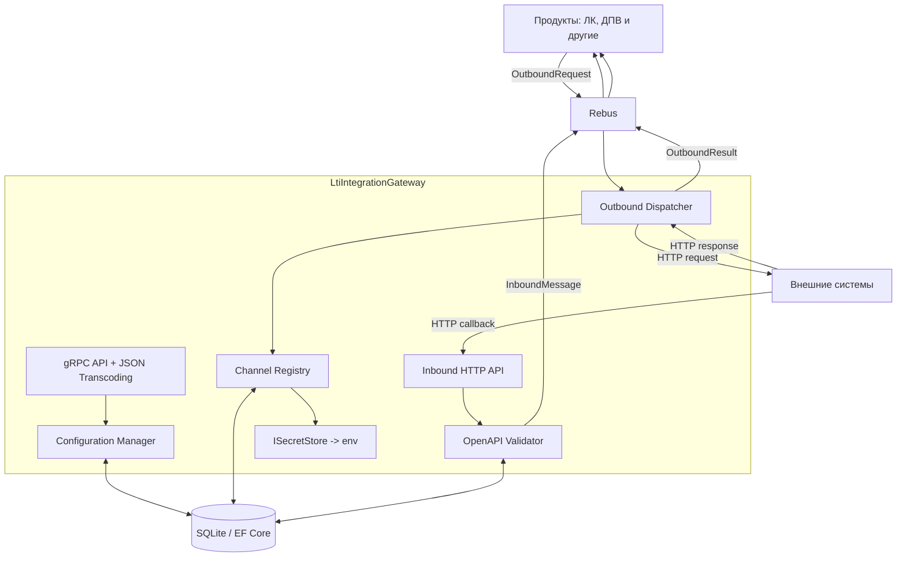

# LtiIntegrationGateway — архитектура и технические требования

**Статус:** проектное решение
**Версия документа:** 1.3
**Дата:** 29.10.2026
**Предыдущая версия:** 1.2

## 0. Что изменилось в версиях 1.2 и 1.3

Версия 1.2 закрыла решения по исходящему контуру, версия 1.3 — по входящему. Таблицы
приведены для трассировки: что решено и в каком разделе это записано.

### Версия 1.2

Версия 1.2 закрывает решения, без которых нельзя начать реализацию исходящего контура.

| № | Решение | Раздел |
|---|---------|--------|
| 1 | Тулчейн: `Google.Protobuf` + `Grpc.Tools`; собственный `ISerializer` для Rebus на `JsonFormatter`/`JsonParser` | 5.3 |
| 2 | Формат тела в Rebus — ProtoJSON; неизвестные поля игнорируются | 5.3 |
| 3 | Версионирование контрактов и распространение только через `.proto` | 5.4, 5.5 |
| 4 | Идентификация продукта: `product_id` в сообщении + сверка с `rbs2-sender-address` по `ProductRoutes` | 8.2, 8.8, 11.2 |
| 5 | Адрес доставки `OutboundResult` — `rbs2-return-address`, проверенный по allow-list | 8.8 |
| 6 | Устойчивость результата: журнал сообщений как носитель недоставленных результатов + фоновый диспетчер (вторым шагом) | 8.9 |
| 7 | Тела — `bytes`, имена `body` / `response_body`; `path_parameters` удалено; `query_parameters` — `repeated {name, value}` | 8.3, 8.5, 9.3 |
| 8 | Ретраи выполняются внутри обработки Rebus-сообщения по конфигурации клиента; исход HTTP-вызова никогда не является исключением | 8.6 |
| 9 | Классификация ошибок для ретраев — только транспорт и HTTP-статус | 8.6 |
| 10 | Валидация исходящего пути: структурная проверка + allow-list шаблонов канала; `AllowAutoRedirect = false` | 8.7 |
| 11 | Типы авторизации: `none`, `bearer`, `api_key`, `basic`, `client_certificate`; секреты только в переменных окружения | 7.5 |
| 12 | Пул HTTP-обработчиков по ключу (base URL, тип авторизации, отпечаток сертификата) | 7.7 |

### Версия 1.3

| № | Решение | Раздел |
|---|---------|--------|
| 13 | Входящие документы: целевой OpenAPI 3.0; Swagger 2.0 конвертируется при загрузке; 3.1 отклоняется | 14 |
| 14 | Валидация тела: NJsonSchema за абстракцией в `Infrastructure/OpenApi` | 14 |
| 15 | Загрузка контракта fail-closed: перечень поддерживаемых конструкций закрыт, отказ возвращает все проблемы сразу | 14 |
| 16 | `$ref` только локальный; ссылки на `http`, `https`, `file` и относительные пути запрещены | 14 |
| 17 | `oneOf`, `anyOf`, `allOf`, `not`, `discriminator` поддерживаются; `$ref` с соседними полями отклоняется | 14 |
| 18 | Аутентификация входящих вызовов: `none`, `api_key`, `basic` + mTLS на уровне хостинга; HMAC — вторым шагом | 7.3, 13 |
| 19 | Дедупликация входящих событий шлюзом не выполняется; ключ дедупликации из контура исключён | 10.3 |
| 20 | Ответ внешней системе: `202` после успешного `Send`, `503` при неудаче; `200` не используется | 9.5 |
| 21 | Динамическая маршрутизация: кастомный `EndpointDataSource` + обязательный spike; fallback — собственный матчер | 5.2 |
| 22 | Конфликт шаблонов маршрутов обнаруживается при публикации ревизии, не в рантайме | 5.2, 15.3 |
| 23 | Управляющий API: `api_key` из env; персональная идентичность и роли — открытый вопрос | 13, 15 |
| 24 | Идемпотентность исходящей операции: уникальный `message_id`, повтор не вызывает внешнюю систему | 8.10, 11.2 |
| 25 | Все входящие и исходящие сообщения сохраняются в БД для аудита и разбора инцидентов, срок хранения — бессрочный | 11.2, 13 |
| 26 | Inbound-маршруты генерируются из операций контракта; настройки операции (`enabled`, очередь, лимит) переопределяют настройки контракта; лимит частоты на контракт | 7.3, 13, 15.2 |
| 27 | Лимиты в приложении: глубина JSON 64 и query-параметров 64; размер тела регулируется на уровне nginx | 9.5, 13 |
| 28 | Имена очередей: `lti.gateway.outbound`, `lti.gateway.error`, `<product_id>.inbox` (вычисляется из `product_id`) | 10.2 |

**Что остаётся открытым.** Провайдер секретов в production (кроме env), провайдер
`DistributedLock`, OAuth2 client credentials для каналов, промышленный транспорт Rebus и
промышленная база данных, наблюдаемость (OTel, метрики, health/readiness, лимиты Kestrel),
переход управляющего API на JWT корпоративного IdP, CI и публикация тегов контрактов —
раздел 20.

Ближайшая реализация — исходящий контур (разделы 8, 10, 11); требования входящего контура
остаются целевыми и не блокируют первый этап.

## 1. Назначение

`LtiIntegrationGateway` — самостоятельное приложение для интеграции продуктов с внешними
системами: банками, депозитариями и другими внешними API.

Шлюз предоставляет единый механизм для:

- приёма HTTP-запросов от внешних систем;
- валидации входящих данных по OpenAPI/Swagger;
- передачи входящих данных продуктам через Rebus;
- выполнения исходящих HTTP-запросов по сообщениям из Rebus;
- возврата результатов исходящих вызовов через Rebus;
- централизованного управления каналами, авторизацией, контрактами и конфигурацией;
- обработки ошибок, повторных попыток и аудита.

### Основной принцип

**Взаимодействие продуктов со шлюзом выполняется исключительно через Rebus.** Продукты
не вызывают REST или gRPC API шлюза для передачи бизнес-данных и получения результатов
интеграционных операций.

REST и gRPC используются для интерфейсов управления и администрирования, а также для
задач, где нужен соответствующий API.

Шлюз не является бизнес-сервисом и не выполняет бизнес-маппинг данных. Он отвечает за
транспорт, каналы, авторизацию, входную валидацию и надёжную доставку сообщений. Из
этого принципа следует решение 9 версии 1.2: правила повторов не могут зависеть от
содержимого тела ответа внешней системы.

## 2. Технологический стек

| Область | Решение |
|---|---|
| Платформа | .NET 10 (`net10.0`) |
| Язык | C# |
| Стиль разработки | Feature-first, Vertical Slice Architecture |
| Контракты | Protocol Buffers, contract-first |
| Генерация C# из `.proto` | `Grpc.Tools` (типы `Google.Protobuf`) |
| API управления | gRPC с JSON transcoding для REST-доступа |
| Сериализация сообщений Rebus | ProtoJSON через собственный `ISerializer` (5.3) |
| Обмен сообщениями | Rebus; целевая ветка 8.9.x, поддерживает `net10.0` |
| Транспорт Rebus на начальном этапе | In-memory; входит в ядро Rebus (`Rebus.Transport.InMem`), отдельный пакет не требуется |
| Хранение конфигурации | EF Core + SQLite |
| Тестовая база данных | SQLite `:memory:` |
| Блокировки | DistributedLock с адаптером под выбранный механизм хранения и координации |
| Тестирование | TUnit и необходимые дополнительные модули |
| Входящие HTTP-контракты | OpenAPI 3.0; Swagger 2.0 — через конвертацию при загрузке (14) |
| Чтение и конвертация входящих документов | `Microsoft.OpenApi` (`OpenApiDocument.LoadAsync`) |
| Валидация входящего тела по схеме | `NJsonSchema` за абстракцией в `Infrastructure/OpenApi` |
| Исходящие HTTP-вызовы | `IHttpClientFactory` + `Microsoft.Extensions.Http.Resilience` 10.x |
| Хранение секретов | Переменные окружения, доступ через `IConfiguration` (7.5) |

Конкретные версии пакетов фиксируются в проекте и обновляются контролируемо.

SQLite и in-memory-транспорт являются стартовым вариантом реализации. Они не должны
создавать жёсткую зависимость бизнес-логики от конкретного транспорта или поставщика
базы данных.

## 3. Структура решения и границы проекта

Решение состоит из двух проектов:

- `LtiIntegrationGateway` — всё приложение и его производственный код;
- `LtiIntegrationGateway.Tests` — автоматические тесты.

Дополнительные проекты для `Domain`, `Application`, `Infrastructure`, `ManagementApi` или
других слоёв **не создаются**. Разделение ответственности реализуется каталогами,
пространствами имён и вертикальными срезами внутри одного приложения.

Фактическая структура репозитория (в версии 1.2 приведена в соответствие с репозиторием):

```text
LtiIntegrationGateway.slnx                    <- решение в корне
│
├── src/
│   ├── LtiIntegrationGateway/
│   │   ├── Program.cs
│   │   ├── Protos/
│   │   │   └── v1/
│   │   │       ├── integration_messages.proto
│   │   │       ├── channel_management.proto
│   │   │       └── contract_management.proto
│   │   ├── Features/
│   │   │   ├── Channels/      (CreateChannel, UpdateChannel, GetChannel, ActivateChannel)
│   │   │   ├── Contracts/     (UploadContract, ValidateContract, PublishContract, RollbackContract)
│   │   │   ├── Inbound/       (ResolveOperation, ValidateRequest, AcceptRequest, PublishMessage)
│   │   │   ├── Outbound/      (ValidateRequest, DispatchRequest, ExecuteHttpCall, PublishResult)
│   │   │   ├── Operations/
│   │   │   └── Configuration/
│   │   ├── Infrastructure/
│   │   │   ├── Persistence/
│   │   │   ├── Rebus/         (ProtobufSerializer, ProtobufMessageRegistry)
│   │   │   ├── DistributedLock/
│   │   │   ├── Http/          (ChannelHttpClientPool)
│   │   │   ├── OpenApi/
│   │   │   ├── Security/      (ISecretStore, ConfigurationSecretStore)
│   │   │   └── Observability/
│   │   └── Configuration/
│   └── LtiIntegrationGateway.Tests/
│       ├── Features/
│       ├── Infrastructure/
│       └── TestSupport/
└── docs/adr/
```

Это рекомендуемая организация, а не требование создавать каждый каталог заранее. Каталог
создаётся, когда в нём появляется соответствующая функциональность.

Проект `LtiIntegrationGateway.Tests` ещё не создан; его создание и подключение обоих
проектов к `LtiIntegrationGateway.slnx` — первая задача ближайшего этапа.

## 4. Принципы проектирования

### 4.1. Feature-first

Код организуется вокруг функциональных возможностей системы, а не по техническим слоям
верхнего уровня.

Например, работа с каналом располагается в `Features/Channels`, а сценарий публикации
контракта — в `Features/Contracts/PublishContract`.

Компоненты, используемые разными функциональными областями, могут находиться в
`Infrastructure` или в общей конфигурации приложения.

### 4.2. Vertical Slice Architecture

Каждый сценарий по возможности содержит необходимые ему обработчик, валидацию, доступ к
данным и результат операции.

Не требуется создавать универсальные сервисы, репозитории и интерфейсы для каждой
сущности только ради следования слоистой архитектуре.

Общие абстракции вводятся тогда, когда они действительно устраняют дублирование или
отделяют инфраструктурную реализацию от сценария использования.

### 4.3. Contract-first на основе Protobuf

Сначала определяется и версионируется контракт в `.proto`, затем из него генерируется
C#-код.

Protobuf-контракты используются для описания gRPC-сервисов, предоставления REST API
через JSON transcoding и определения сообщений, передаваемых через Rebus.

Контракты не должны зависеть от внутренних сущностей EF Core, моделей базы данных или
бизнес-моделей отдельных продуктов.

Изменение опубликованного контракта должно учитывать совместимость с существующими
потребителями (5.4).

### 4.4. Самостоятельность решения

`LtiIntegrationGateway` является отдельным приложением и не зависит от сборок конкретных
продуктов, например ЛК или ДПВ.

**Распространение контрактов (решение версии 1.2).** Единственный публикуемый артефакт
контракта — файлы `.proto`. Пакеты NuGet, отдельные репозитории контрактов и общие сборки
не создаются: потребитель забирает `.proto` из репозитория шлюза и генерирует типы
самостоятельно, любым доступным ему инструментом.

Следствия:

- профиль кодирования сообщений (5.3) обязан быть описан **внутри** `.proto` (шапка файла
  и комментарии), поскольку другого носителя документации у потребителя нет;
- версия контракта определяется `package` в `.proto` и тегом репозитория шлюза;
  потребитель фиксирует у себя конкретный тег или коммит;
- контроль совместимости находится целиком на стороне шлюза: копии у потребителей мы не
  контролируем, поэтому правила полей из 5.5 — единственная защита.

## 5. Контракты Protobuf и gRPC

### 5.1. gRPC и REST

gRPC-сервисы описываются в `.proto`. Для методов, которым нужен REST-доступ, используются
HTTP-аннотации и gRPC JSON transcoding.

Таким образом, один контракт позволяет предоставлять соответствующую операцию как
gRPC-метод и как REST endpoint.

В первую очередь это относится к управлению каналами, контрактами и конфигурацией.

### 5.2. Динамические входящие HTTP endpoint

Для входящих интеграций есть отдельное требование: внешний Swagger JSON загружается в
базу данных, а endpoint-ы активируются без пересборки и перезапуска приложения.

Здесь важно различать два механизма:

- **gRPC JSON transcoding** публикует HTTP-маршруты, описанные в Protobuf-контрактах
  приложения;
- **динамические inbound endpoint** формируются из опубликованной OpenAPI-конфигурации во
  время работы приложения.

Маршруты, хранящиеся в загруженном Swagger JSON, нельзя автоматически сделать новыми
gRPC-методами только за счёт transcoding. Для них используется отдельный механизм
динамической маршрутизации ASP.NET Core.

**Выбранный механизм (версия 1.3).** Кастомный `EndpointDataSource` (с `RouteEndpointBuilder`
и метаданными на endpoint), который перестраивается при активации ревизии конфигурации.
Маршруты регистрируются как настоящие endpoint'ы ASP.NET Core, поэтому штатно работают
метаданные, политики ограничения частоты на маршрут, авторизация и наблюдаемость.

Альтернатива — собственный матчер в middleware поверх `Map("/{**path}")` — оставлена как
зафиксированный fallback: она проще в динамике, но теряет штатные возможности endpoint'ов и
требует собственного разбора шаблонов и правил приоритета.

**Spike обязателен до реализации входящего контура.** Критерии успеха:

1. добавленный в рантайме маршрут начинает обслуживаться без перезапуска приложения;
2. деактивированный маршрут перестаёт обслуживаться (`404`);
3. одновременно активны маршруты двух ревизий контрактов, конфликт шаблонов решается
   детерминированно;
4. политика ограничения частоты, привязанная к endpoint, реально применяется;
5. поведение подтверждено интеграционным тестом на TUnit.

Если spike не проходит, переходим на fallback. Утверждать поведение маршрутизации в
рантайме без проверки на целевой версии .NET нельзя.

**Результат spike (проверено на .NET SDK 10.0.403, Microsoft.AspNetCore.App 10.0.14,
изменение `2026-10-29-inbound-routing-spike`).** Механизм подтверждён, fallback не требуется:

- маршрут, активированный после старта приложения, обслуживает запросы без перезапуска;
  деактивированный маршрут возвращает `404`;
- одновременно активны наборы двух ревизий; конфликт «метод + шаблон» отклоняется при активации
  (внутри набора и с уже активным набором), при этом ранее активный набор продолжает работу.
  Параметрические шаблоны с разными именами (`/a/{id}` и `/a/{name}`) считаются конфликтом;
- пересекающиеся шаблоны разрешаются штатным приоритетом `RoutePattern`: литеральный сегмент
  выигрывает у параметрического, выбор стабилен при повторных запросах;
- ограничение частоты, заданное метаданными endpoint'а, применяется: превышение квоты даёт `429`,
  квоты каналов независимы, после истечения окна запросы снова обслуживаются;
- статические endpoint'ы (например, `/health/live`) не затрагиваются динамическими маршрутами;
- всё перечисленное закреплено интеграционными тестами на TUnit через `WebApplicationFactory`.

Найденные особенности реализации, учтённые в коде:

1. регистрация `EndpointDataSource` только в DI в minimal hosting **не подхватывается** — источник
   нужно добавлять в `IEndpointRouteBuilder.DataSources`, иначе динамические маршруты не обслуживаются;
2. `EndpointDataSource.GetChangeToken()` возвращает `IChangeToken`, поэтому токен каталога
   оборачивается в `CancellationChangeToken`;
3. при совпадении пути и несовпадении метода ASP.NET Core отвечает `405 MethodNotAllowed`, а не `404`.

**Конфликт маршрутов.** Два активных маршрута, совпадающих по HTTP-методу и шаблону, — это
ошибка конфигурации, обнаруживаемая при публикации ревизии (отказ). В рантайме маршрут
никогда не выбирается «как получится».

### 5.3. Protobuf-контракты сообщений Rebus

Все сообщения, которыми обмениваются продукты и шлюз через Rebus, объявляются в `.proto`.
Исходный контракт служит единственным определением транспортной структуры; C#-классы
генерируются из Protobuf и не поддерживаются вручную как отдельные DTO.

**Тулчейн.** Используется `Google.Protobuf` с генерацией из `.proto` через `Grpc.Tools`.
Альтернатива `protobuf-net` / `Rebus.Protobuf` отклонена: пакет `Rebus.Protobuf`
сериализует типы `protobuf-net` (code-first с атрибутами), которые не используются
механизмом gRPC JSON transcoding, и зависит от Rebus 8.0.1. Единственный набор типов,
сгенерированный из `.proto`, обслуживает и gRPC, и Rebus.

**Сериализация.** Rebus требует явной настройки формата тела. Реализуется собственный
`Rebus.Serialization.ISerializer` (два метода — `Serialize` и `Deserialize`):

```text
Serialize(Message message)
    body as IMessage                    (не IMessage -> ошибка, сообщение не отправляется)
    JsonFormatter.Default.Format(body)  -> UTF-8 bytes
    headers[rbs2-msg-type]      = body.Descriptor.FullName
    headers[rbs2-content-type]  = application/json
    -> TransportMessage

Deserialize(TransportMessage transportMessage)
    headers[rbs2-msg-type] -> ProtobufMessageRegistry.Find(fullName)
        тип не найден -> диагностируемая ошибка с именем типа
    descriptor.Parser.ParseFrom(body)   -> IMessage
    -> Message
```

Реестр типов строится один раз при старте из `TypeRegistry.FromMessages(...)` по всем
сообщениям интеграционного окружения; тем же реестром пользуется `JsonParser` при разборе
`google.protobuf.Any`. Регистрация выполняется в `Infrastructure/Rebus`, `Program.cs`
содержит только вызов одной регистрационной точки и не перечисляет сообщения.

**Профиль кодирования (нормативный; дублируется в шапке каждого `.proto`).**

| Правило | Значение |
|---|---|
| Формат тела | ProtoJSON (UTF-8) |
| Печать | `JsonFormatter.Default`: camelCase, enum именем, поля с дефолтным значением опускаются, `bytes` — base64 |
| Разбор | `IgnoreUnknownFields = true`; принимаются и camelCase, и snake_case формы имён |
| Неизвестное имя enum | ошибка разбора; неизвестное числовое значение enum сохраняется (подтверждается тестом) |
| 64-битные целые | передаются строкой (правило ProtoJSON) |
| Заголовок типа | `rbs2-msg-type` = protobuf full name |
| Заголовок содержимого | `rbs2-content-type` = `application/json` |

Толерантность к неизвестным полям выбрана осознанно: бинарный protobuf по определению
игнорирует неизвестные поля, и без этой настройки добавление поля продуктом ломало бы
старый шлюз, что противоречит требованию независимого обновления продуктов.

**Ограничения и принятые издержки.**

- поля `body` и `response_body` объявлены как `bytes`; в ProtoJSON они кодируются base64,
  что даёт примерно треть дополнительного объёма — принимается ради возможности сменить
  сериализатор на бинарный без изменения `.proto`;
- `google.protobuf.Any` в интеграционных сообщениях **запрещён**: требует регистрации
  типов у каждого потребителя и расширяет поверхность атаки при разборе данных;
- JSON-экранирование символов `"`, `<`, `>`, `&` не настраивается и увеличивает тело,
  содержащее такие символы — принимается.

**Правила совместимости сообщений.** Номер поля не переиспользуется никогда; удалённое
поле заменяется `reserved` по номеру и по имени. Семантика существующего поля не меняется
без новой версии контракта.

### 5.4. Версионирование контрактов

- Окружение сообщений: `package lti.gateway.messages.v1`, `csharp_namespace`
  `LtiIntegrationGateway.Contracts.Messages.V1`.
- Внутри версии допускаются только добавочные изменения: новые поля, новые типы
  сообщений, новые значения закрытых enum.
- Несовместимое изменение (изменение смысла поля, смена типа, удаление обязательного поля)
  оформляется как новое окружение `...v2` в отдельном наборе файлов.
- Шлюз какое-то время поддерживает `v1` и `v2` одновременно: сообщения различаются
  заголовком `rbs2-msg-type`, обе версии обрабатываются в одной очереди. Версия
  контракта **не** кодируется в имени очереди.
- Удаление поддержки `v1` — отдельное решение, принимаемое после миграции потребителей.

### 5.5. Правила описания `.proto`

| Правило | Обоснование |
|---|---|
| Имена полей — `snake_case` | стиль protobuf; на проводе всё равно camelCase |
| `optional` для скаляров, где важно различие «не задано» и «значение по умолчанию» (`idempotency_key`, `error_code`, `content_type`) | ProtoJSON опускает поля с дефолтным значением |
| `enum` только для закрытых множеств, которые не расширяются без новой версии; расширяемые классификаторы — `string` | неизвестное имя enum — ошибка разбора |
| Нулевое значение enum — `*_UNSPECIFIED` | требование стиля protobuf |
| Номера полей не переиспользуются; удалённые помечаются `reserved` | единственная защита совместимости при схеме «`.proto` без пакета» |
| `Any` запрещён; `Struct` и `Value` не используются для тел сообщений | тело передаётся как `bytes` (8.3) |
| `Timestamp` используется для моментов времени | предсказуемое представление в ProtoJSON |

## 6. Общая архитектура интеграций

Система разделена на два независимых runtime-контура.

- **Outbound Dispatcher** получает сообщения из Rebus и вызывает внешние HTTP API.
- **Inbound HTTP API** принимает вызовы внешних систем, определяет активную
  OpenAPI-операцию, проверяет запрос и передаёт его через Rebus продукту.

Управляющая часть отвечает за каналы, секреты, контракты, версии конфигурации и аудит.



Rebus in-memory используется на начальном этапе. При переходе к промышленному транспорту
должны сохраняться те же логические контракты сообщений и правила маршрутизации.

## 7. Каналы и конфигурация

### 7.1. Channel

Канал — зарегистрированное подключение к внешней системе. Канал определяет:

- уникальное имя (`channel_name`);
- базовый URL (абсолютный, `https`, без userinfo);
- тип авторизации и имя ключа конфигурации с секретом (7.5);
- таймаут одной попытки и общий предел длительности операции (7.6);
- политику повторных попыток (7.6);
- требования к TLS (7.5, 7.7);
- допустимые HTTP-методы и шаблоны относительных путей (8.7);
- ограничения соединения.

Пример канала — `bank-a`.

Канал не описывает бизнес-операции внешнего API. В исходящем запросе продукт выбирает
канал и задаёт относительный путь.

Канал не содержит значений секретов: в конфигурации хранится только тип авторизации и имя
ключа конфигурации, из которого берётся значение (7.5).

### 7.2. Inbound Contract

Входящий контракт — загруженный OpenAPI/Swagger JSON, описывающий HTTP-операции, которые
внешняя система может вызывать на шлюзе.

Контракт определяет:

- пути и HTTP-методы;
- параметры запросов;
- схемы тела запроса;
- допустимые Content-Type;
- `operationId`, если он указан;
- ограничения и требования к входным данным.

### 7.3. Inbound Route

Маршрут связывает входящий endpoint с контрактом и очередью получателя в Rebus.

Он содержит:

- HTTP-метод;
- шаблон относительного пути;
- ссылку на контракт и его ревизию;
- `operationId`, если он задан;
- идентификатор канала или внешней системы;
- целевую очередь продукта;
- настройки аутентификации и валидации.

**Изменение версии 1.2.** Настройка аутентификации входящего маршрута хранит тип
авторизации и имя ключа конфигурации, из которого берётся секрет — по той же схеме, что и
канал (7.5). Значения секретов в базе не хранятся.

**Типы аутентификации входящего маршрута (версия 1.3):**

| Тип | Материал | Проверка |
|---|---|---|
| `none` | — | допускается только для сред разработки и тестов |
| `api_key` | значение ключа в env | сравнение за постоянное время; имя заголовка хранится в маршруте |
| `basic` | пароль в env | пользователь хранится в маршруте, сравнение за постоянное время |
| `client_certificate` | сертификат клиента | проверяется хостингом, приложение доверяет факту валидного сертификата |

Дополнительно маршрут содержит настройки ограничения частоты (лимит и окно) и признак
`enabled`. Подпись HMAC-SHA256 (тело, `timestamp`, `nonce`) в контур не входит и
рассматривается как отдельное решение.

**Генерация маршрутов (решение 1.3).** При публикации контракта маршрут создаётся для каждой
операции документа. Значения по умолчанию — очередь получателя, авторизация и лимит
частоты — берутся из настроек контракта; настройки отдельной операции их переопределяют.

- включённая операция без очереди получателя — отказ публикации, а не `404` в рантайме;
- отключённая операция (`enabled = false`) не обслуживается: ответ `404`, при этом событие
  попадает в аудит с указанием, что путь известен, но операция отключена;
- перечень операций контракта и их настройки видны в управляющем API (15.2); признак
  `enabled` меняется без перезапуска приложения;
- при публикации новой ревизии настройки операций переносятся по совпадению `operationId`,
  HTTP-метода и шаблона пути; для новых операций применяются настройки по умолчанию.

**Приоритет сопоставления маршрутов.** literal-сегмент приоритетнее параметра `{id}`,
параметр приоритетнее catch-all. Равенство специфичности при одинаковых методе и шаблоне —
отказ публикации (5.2).

### 7.4. Динамическая конфигурация

Добавление канала, загрузка контракта, изменение маршрута и публикация новой ревизии не
должны требовать пересборки или перезапуска приложения.

Опубликованные ревизии конфигурации и контрактов неизменяемы. Новая конфигурация сначала
валидируется, затем публикуется и активируется.

Runtime использует согласованные снимки конфигурации. Уже начатый запрос должен
обрабатываться в рамках той ревизии, с которой он был начат.

**Ограничение по секретам.** Значения секретов читаются из переменных окружения, которые
.NET не перечитывает во время работы приложения. Поэтому изменение секрета вступает в
силу только после перезапуска шлюза. Ограничение относится именно к секретам:
конфигурация каналов и контрактов от перезапуска не зависит.

### 7.5. Авторизация исходящих вызовов и секреты

Поддерживаемые в версии 1.2 типы авторизации канала:

| Тип | Материал секрета | Где хранится секрет |
|---|---|---|
| `none` | нет | — |
| `bearer` | токен | переменные окружения |
| `api_key` | значение ключа; имя заголовка или query-параметра хранится в БД и не является секретом | переменные окружения |
| `basic` | пароль; имя пользователя хранится в БД и не является секретом | переменные окружения |
| `client_certificate` | клиентский сертификат (PFX) и пароль к нему | переменные окружения |

В базе данных хранятся только:

- `auth_type` — тип авторизации;
- `config_key` — имя ключа конфигурации, например `Secrets:BankA:Token`;
- несекретные параметры (имя заголовка, имя query-параметра, имя пользователя).

Соответствие переменных окружения ключам конфигурации: `Secrets__BankA__Token` в окружении
соответствует ключу `Secrets:BankA:Token`.

Требования:

- значения секретов не попадают в базу данных, в сообщения Rebus, в `OutboundResult`, в
  ответы управляющего API и в логи;
- при старте и при проверке канала отсутствие ключа или пустое значение диагностируется как
  `secret key missing (key: <имя>)` без раскрытия значения;
- OAuth2 client credentials в версии 1.2 не поддерживается (раздел 20).

### 7.6. Политика повторов канала

Политика хранится в составе ревизии конфигурации канала (неизменяема) и состоит из
упорядоченного списка правил:

```text
rule
  match        : transport_error | http_status_in [429, 500, 502, 503, 504]
  delays       : [1000ms, 2000ms, 4000ms]
per_attempt_timeout : 30s
overall_cap         : 120s
```

Правила:

- количество повторов равно длине массива `delays`; отдельного поля «количество повторов»
  нет, чтобы состояние не могло стать противоречивым;
- применяется первое совпавшее правило; порядок правил значим;
- `Retry-After` в ответах `429` и `503` уважается как часть HTTP-протокола: если он больше
  соответствующей задержки, используется он; если больше `overall_cap`, повторы
  прекращаются;
- `POST` и `PATCH` повторяются только при непустом `idempotency_key`;
- превышение `overall_cap` прекращает повторы и формирует результат, а не исключение;
- значения по умолчанию для канала без явной политики: `transport_error` и
  `http_status_in [429,500,502,503,504]`, `delays=[1000,2000,4000]`,
  `per_attempt_timeout=30s`, `overall_cap=120s`, максимум пять задержек.

Повторы выполняются внутри обработки одного сообщения Rebus, поэтому воркер занят на всё
время операции; `overall_cap` и количество воркеров должны это учитывать.

### 7.7. Жизненный цикл HTTP-соединения

Клиентский сертификат предъявляется в TLS-рукопожатии, то есть на уровне соединения, а не
отдельного запроса. Поэтому HTTP-обработчик нельзя переиспользовать между каналами с
разными сертификатами, а каналы задаются в базе и меняются без перезапуска.

Применяется пул собственных `SocketsHttpHandler` с ключом
`(base_url, auth_type, отпечаток сертификата)`:

- при смене ревизии канала или сертификата создаётся новый обработчик, старый выводится из
  эксплуатации по сроку жизни;
- серверный сертификат валидируется всегда; отключение проверки не допускается;
- минимальная версия TLS — 1.2;
- автоматическое следование редиректам отключено (8.7).

Альтернативы отклонены: именованные `HttpClient` из конфигурации на старте требуют знания
каналов заранее и перезапуска при смене сертификата, что противоречит 7.4; создание
обработчика на каждый вызов теряет пул соединений и добавляет TLS-рукопожатие к каждому
запросу.

## 8. Исходящий контур — Outbound

### 8.1. Ответственность продукта

Продукт самостоятельно знает бизнес-операцию, HTTP-метод, относительный путь внешнего API,
параметры запроса, структуру JSON и правила интерпретации ответа. Продукт также указывает
собственный идентификатор `product_id`.

Продукт отправляет `OutboundRequest` через Rebus в очередь шлюза.

### 8.2. Ответственность шлюза

1. Получает сообщение из очереди исходящих запросов.
2. Проверяет наличие `rbs2-sender-address`, допустимость отправителя и соответствие
   `product_id` конфигурации `ProductRoutes` (8.8).
3. Проверяет право продукта использовать указанный канал.
4. Загружает активную конфигурацию канала.
5. Проверяет допустимость HTTP-метода и относительного пути (8.7).
6. Получает материал секрета по `config_key` и формирует заголовки авторизации.
7. Формирует и выполняет HTTP-запрос с политикой повторов канала (7.6).
8. Сохраняет состояние операции и результат (8.9).
9. Передаёт `OutboundResult` через Rebus в проверенную очередь продукта (8.8).

Шлюз не требует OpenAPI для исходящего вызова и не выполняет бизнес-маппинг тела запроса.

**Исход HTTP-вызова никогда не является исключением.** Любой полученный ответ, таймаут,
отказ соединения или отказ самого шлюза превращается в `OutboundResult`. Исключения в
обработчике означают только инфраструктурный сбой шлюза (не удалось прочитать
конфигурацию, записать состояние или отправить результат) и приводят к повтору Rebus.

### 8.3. Контракт OutboundRequest

| Поле | Тип | Назначение |
|---|---|---|
| `message_id` | `string` | Уникальный идентификатор запроса; повторная отправка с тем же значением трактуется как та же операция |
| `product_id` | `string` | Идентификатор продукта, формат `^[a-z][a-z0-9-]{1,31}$` |
| `channel_name` | `string` | Имя зарегистрированного канала |
| `relative_path` | `string` | Относительный путь внешнего API; обязан начинаться с `/` |
| `http_method` | `string` | HTTP-метод в верхнем регистре |
| `content_type` | `optional string` | Тип тела запроса; при непустом `body` обязателен |
| `body` | `bytes` | Тело запроса в исходном виде; в ProtoJSON кодируется base64 |
| `query_parameters` | `repeated QueryParameter` | Query-параметры с сохранением порядка и повторов |
| `correlation_id` | `optional string` | Идентификатор бизнес-процесса |
| `idempotency_key` | `optional string` | Ключ идемпотентности; наличие разрешает повтор `POST`/`PATCH` |

`QueryParameter` содержит `name` и `value`. Тип `repeated` выбран потому, что внешние API
используют повторяющиеся параметры (`?account=1&account=2`), а `map<string, string>` их
выразить не может и теряет значения молча.

Поле `body` намеренно не имеет суффикса `json`: формат задаётся `content_type`, а
содержимое может быть не только JSON. Тело передаётся байтами, чтобы сохранить исходное
представление числовых значений и не зависеть от универсальной объектной модели.

Абсолютный URL, секреты и произвольные заголовки авторизации в сообщение не передаются.
Произвольные заголовки запроса контрактом не предусмотрены.

### 8.4. Пример запроса

```json
{
  "messageId": "d7a7e0c5-3f62-48e4-8a18-55d19e219cc0",
  "productId": "dpv",
  "channelName": "bank-a",
  "relativePath": "/api/contracts",
  "httpMethod": "POST",
  "contentType": "application/json",
  "correlationId": "process-123",
  "idempotencyKey": "dkp-456",
  "queryParameters": [{ "name": "mode", "value": "full" }],
  "body": "eyJjb250cmFjdE51bWJlciI6IkRLUC00NTYiLCJhbW91bnQiOjE1MDAwMH0="
}
```

Пример иллюстрирует логическую структуру. Поле `body` показано уже в кодировке base64, как
оно выглядит в ProtoJSON.

### 8.5. Контракт OutboundResult

Результат передаёт фактический исход HTTP-вызова, а не факт обработки сообщения Rebus.

| Поле | Тип | Назначение |
|---|---|---|
| `message_id` | `string` | Идентификатор исходного запроса |
| `product_id` | `string` | Идентификатор продукта |
| `channel_name` | `string` | Имя канала |
| `outcome` | `Outcome` (enum) | `HTTP_RESPONSE`, `TRANSPORT_ERROR`, `GATEWAY_REFUSED` |
| `http_status_code` | `optional int32` | HTTP-статус, если ответ получен |
| `content_type` | `optional string` | Content-Type ответа |
| `response_body` | `bytes` | Тело ответа в исходном виде |
| `error_code` | `optional string` | Код отказа шлюза или транспортной ошибки |
| `error_message` | `optional string` | Безопасное описание, без внутренних деталей конфигурации |
| `correlation_id` | `optional string` | Идентификатор бизнес-процесса |
| `attempt_count` | `int32` | Количество выполненных попыток |

Необходимо отличать полученный HTTP-ответ от невозможности получить ответ: ответ `500`
означает, что внешний сервис вернул HTTP-ответ, а таймаут означает, что результат операции
может быть неизвестен. Шлюз передаёт фактический статус и тело; интерпретация результата
остаётся ответственностью продукта.

Коды отказов шлюза (`GATEWAY_REFUSED`): `PRODUCT_NOT_ALLOWED`, `CHANNEL_NOT_ALLOWED`,
`METHOD_NOT_ALLOWED`, `PATH_NOT_ALLOWED`, `INVALID_PATH`, `INVALID_REQUEST`,
`SECRET_NOT_CONFIGURED`. Коды транспортных ошибок (`TRANSPORT_ERROR`): `TIMEOUT`,
`CONNECTION_FAILED`, `TLS_FAILED`, `RETRIES_EXHAUSTED`.

### 8.6. Ошибки и повторные попытки

Классификация ошибок выполняется **только** по транспорту и HTTP-статусу:

| Класс | Признак | Повтор |
|---|---|---|
| Временная транспортная ошибка | таймаут, отказ соединения, DNS, TLS | по политике канала |
| Ограничение частоты | `429` | по политике канала, с учётом `Retry-After` |
| Ошибка сервера | `5xx` | по политике канала |
| Постоянная ошибка клиента | `4xx`, кроме `408` и `429` | нет |
| Ошибка авторизации | `401`, `403` | нет |
| Ошибка конфигурации или отказ шлюза | определяется до HTTP-вызова | нет |

Правила по содержимому тела ответа (например, `200` с полем `errorCode`) **не
применяются**: шлюз не выполняет бизнес-маппинг, поэтому решение о повторе в таком случае
принимает продукт, отправив новый `OutboundRequest` с бизнес-контекстом, которого у шлюза
нет.

Небезопасный `POST`/`PATCH` повторяется только при непустом `idempotency_key`. После
исчерпания повторов шлюз передаёт результат с `outcome=TRANSPORT_ERROR` и кодом
`RETRIES_EXHAUSTED`; при полученном HTTP-ответе — `outcome=HTTP_RESPONSE` с фактическим
статусом.

### 8.7. Валидация исходящего запроса и защита от SSRF

Проверка выполняется до HTTP-вызова в два слоя.

**Слой 1 — структурная проверка `relative_path`** (безусловная, не конфигурируется):

- обязан начинаться с `/`;
- запрещены схема (`http:`, `https:`), `://`, хост и authority;
- запрещено `//` в начале и внутри пути: `//evil.example` при склейке с базовым адресом
  даёт обращение к чужому хосту;
- запрещены сегменты `.` и `..`;
- запрещены `\`, символы CR и LF, управляющие символы, пробелы по краям;
- запрещены `#` и `?` внутри пути: query собирается отдельно из `query_parameters`;
- ограничение длины — 2048 символов;
- путь не нормализуется молча: невалидное значение отклоняется.

**Слой 2 — конфигурация канала:**

- `allowed_methods` — список разрешённых методов;
- `allowed_path_templates` — список шаблонов (`/api/contracts`, `/api/contracts/{id}`);
  путь, не совпавший ни с одним шаблоном, отклоняется.

Дополнительно:

- базовый URL берётся только из конфигурации канала и должен быть абсолютным `https` без
  userinfo;
- автоматическое следование редиректам отключено; ответ `3xx` передаётся продукту как
  обычный результат;
- заголовок `Host` не переносится из сообщения.

Отказ любого слоя формирует `OutboundResult` с `outcome=GATEWAY_REFUSED` и соответствующим
кодом; HTTP-вызов не выполняется.

### 8.8. Адресация результата и идентичность продукта

- `OutboundRequest` обязан содержать `product_id` и приходить с заголовком
  `rbs2-sender-address`; отсутствие любого из них — отказ без вызова внешнего API.
- `rbs2-sender-address` сверяется с `ProductRoutes`: адрес должен быть разрешён для
  `product_id`. Расхождение — отказ `PRODUCT_NOT_ALLOWED`, резервного варианта нет.
- Адрес доставки результата — `rbs2-return-address` входящего сообщения, проверенный по
  тому же allow-list. Он сохраняется в состоянии операции, потому что результат может
  отправляться значительно позже, после повторов и перезапуска процесса.
- `Reply` не используется: он доступен только внутри обработки сообщения, а результат
  формируется асинхронно, после HTTP-вызова.
- Идентичность отправителя декларативна. В in-memory-транспорте она не проверяется.
  Требование к промышленному транспорту — контроль доступа к очередям на стороне брокера.

Порядок проверки идентичности:

```text
нет rbs2-sender-address                      -> отказ, код PRODUCT_NOT_ALLOWED
адрес не найден в ProductRoutes              -> отказ, код PRODUCT_NOT_ALLOWED
product_id отсутствует или пуст              -> отказ, код INVALID_REQUEST
product_id не соответствует адресу           -> отказ, код PRODUCT_NOT_ALLOWED
канал не разрешён этому product_id           -> отказ, код CHANNEL_NOT_ALLOWED
```

### 8.9. Устойчивость результата

Встроенный outbox Rebus поддерживает только Microsoft SQL Server, поэтому на SQLite он
недоступен. Отдельная таблица outbox не создаётся: её роль выполняет журнал сообщений
(`OutboundMessageLog`, 11.2), который и так хранит полное тело результата.

```text
1. Проверка сообщения и канала; при отказе -- переход к шагу 4.
2. HTTP-вызов с политикой повторов канала.
3. Одна транзакция БД:
     OutboundOperations  -> status = Completed, исход, число попыток
     OutboundMessageLog  -> тела запроса и ответа, адрес доставки,
                            delivery_status = pending
4. Коммит; затем попытка Send; при успехе delivery_status = sent.
5. Фоновый диспетчер читает записи delivery_status = pending (индекс по полю)
   и отправляет повторно, помечая sent.
```

Гарантия — «минимум один раз» для результата. Дубли допустимы, поэтому продукт дедуплицирует
по `message_id` (8.10).

`delivery_status` — единственная служебная изменяемая колонка журнала: остальные данные
записи неизменяемы, тело результата не перезаписывается.

Состояние операции доступно через `GET /v1/operations/{messageId}` (15.2) как средство
диагностики, а не как обязательный шаг продукта.

Реализация разбивается на два шага: сначала состояние операции и запись в журнал, затем
фоновый диспетчер. На in-memory-транспорте журнал переживает рестарт процесса, но получатель
in-memory-очереди — нет: полная гарантия появляется только с промышленным транспортом.

### 8.10. Идемпотентность исходящей операции

`message_id` идентифицирует операцию, а не отдельную доставку сообщения. В
`OutboundOperations` действует уникальный индекс по `message_id`, состояние операции
меняется по шагам `Accepted` → `InProgress` → `Completed`.

Поведение при повторном `OutboundRequest` с тем же `message_id`:

| Состояние операции | Действие шлюза |
|---|---|
| `Completed` | HTTP-вызов не выполняется; сохранённый `OutboundResult` отправляется повторно |
| `InProgress` | HTTP-вызов не выполняется; результат придёт один раз по завершении первой операции |
| отсутствует | операция создаётся и выполняется как обычно |

Дополнительные правила:

- `product_id` участвует в проверке владения: запрос с чужим `product_id` и совпадающим
  `message_id` отклоняется кодом `PRODUCT_NOT_ALLOWED`, а не получает чужой результат;
- повторная отправка сохранённого результата выполняется на адрес из **текущего**
  сообщения (`rbs2-return-address`), потому что продукт мог переехать на другую очередь;
- сохранённый результат передаётся без изменений: повтор обязан быть идентичным первому.

Это закрывает сценарий «продукт потерял `OutboundResult` и переотправил запрос»: повторный
вызов внешней системы не выполняется, а продукт получает тот же результат.

## 9. Входящий контур — Inbound

### 9.1. Использование OpenAPI

Для входящих интеграций используется готовый Swagger/OpenAPI JSON, загружаемый в базу
данных через управляющий интерфейс. На его основе шлюз определяет доступные HTTP-операции,
создаёт динамические endpoint-ы и валидирует поступающие запросы.

Добавление новой операции через опубликованный контракт не требует пересборки или
перезапуска приложения.

Версия OpenAPI, библиотека валидации и правила загрузки документа зафиксированы в разделе 14.

### 9.2. Порядок обработки

1. Внешняя система вызывает HTTP endpoint шлюза.
2. Шлюз выполняет аутентификацию и проверяет разрешённость вызова.
3. По фактическому HTTP-методу и пути определяется операция OpenAPI.
4. Загружается согласованная активная ревизия контракта и маршрута.
5. Проверяются Content-Type, параметры и тело запроса.
6. JSON валидируется по схеме входящей операции.
7. Создаётся универсальное сообщение `InboundMessage`.
8. Сообщение надёжно передаётся через Rebus в очередь продукта.
9. Внешней системе возвращается `202 Accepted` после успешной передачи сообщения в Rebus;
   если передать сообщение не удалось — `503 Service Unavailable`.

Если валидация не пройдена, сообщение не передаётся продукту. Если запрос не удалось
надёжно принять, шлюз не должен подтверждать успешный приём.

### 9.3. Контракт InboundMessage

| Поле | Тип | Назначение |
|---|---|---|
| `message_id` | `string` | Идентификатор, назначенный шлюзом |
| `channel_name` | `string` | Имя канала или идентификатор внешней системы |
| `http_method` | `string` | Фактически вызванный HTTP-метод |
| `relative_path` | `string` | Фактический относительный путь запроса |
| `route_template` | `string` | Шаблон пути из OpenAPI |
| `operation_id` | `optional string` | `operationId` из OpenAPI, если задан |
| `content_type` | `optional string` | Content-Type исходного запроса |
| `body` | `bytes` | Тело запроса в исходном виде |
| `query_parameters` | `repeated QueryParameter` | Query-параметры с сохранением порядка и повторов |
| `received_at` | `Timestamp` | Время получения запроса |
| `external_message_id` | `optional string` | Идентификатор события от внешней системы, если передан |
| `correlation_id` | `optional string` | Идентификатор связанного процесса, если определён достоверно |

**HTTP-метод и фактический относительный путь обязательны.** Это позволяет продукту
однозначно понять, в рамках какого endpoint получены данные.

**Изменения версии 1.2.**

- поле `payload_json` переименовано в `body` и объявлено как `bytes`: формат задаётся
  `content_type`, содержимое может быть не только JSON;
- поле `path_parameters` удалено как избыточное: продукт получает `relative_path` и
  `route_template` и разбирает параметры сам;
- `query_parameters` объявлено как `repeated QueryParameter`, чтобы не терять повторяющиеся
  параметры.

**Семантика `relative_path`:**

- передаётся ровно в том виде, в котором пришёл запрос;
- query string не включается;
- percent-кодирование не снимается;
- слэши, регистр и завершающий `/` не нормализуются;
- `route_template` берётся из OpenAPI в исходном написании, например
  `/callbacks/contracts/{id}/status`.

Продукт самостоятельно решает, декодировать ли сегменты перед разбором.

`external_message_id` заполняется только тогда, когда внешний сервис действительно передал
соответствующий идентификатор. `message_id` шлюза нельзя выдавать за внешний идентификатор
события.

### 9.4. Пример входящего запроса

```http
POST /callbacks/dkp-status?source=bank HTTP/1.1
Content-Type: application/json
```

```json
{
  "contractNumber": "DKP-456",
  "status": "Signed",
  "signedAt": "2026-10-29T10:15:00Z"
}
```

Логическое сообщение:

```json
{
  "messageId": "f20f2b25-64b0-4ad2-8d0a-4f4bbfdd53d1",
  "channelName": "bank-a",
  "httpMethod": "POST",
  "relativePath": "/callbacks/dkp-status",
  "routeTemplate": "/callbacks/dkp-status",
  "operationId": "receiveDkpStatus",
  "contentType": "application/json",
  "queryParameters": [{ "name": "source", "value": "bank" }],
  "body": "eyJjb250cmFjdE51bWJlciI6IkRLUC00NTYiLCJzdGF0dXMiOiJTaWduZWQiLCJzaWduZWRBdCI6IjIwMjYtMTAtMjlUMTA6MTU6MDBaIn0="
}
```

### 9.5. HTTP-ответ внешней системе

Всегда отвечаем `202 Accepted` после успешной передачи сообщения в Rebus (`Send`). Если
передать сообщение не удалось, отвечаем `503 Service Unavailable`: ложный успех недопустим,
внешняя система должна повторить вызов.

`200 OK` не используется, так как обработка асинхронная и на момент ответа продукт ещё не
получил сообщение.
Ограничение: на in-memory-транспорте падение процесса сразу после `Send` теряет событие.
Это ограничение транспорта (10.1), а не схемы приёма; outbox для входящего контура не
предусматривается.

Предусматриваются следующие категории ошибок:

- `400 Bad Request` — синтаксически некорректный запрос;
- `401 Unauthorized` и `403 Forbidden` — ошибки аутентификации или авторизации;
- `404 Not Found` — неизвестный endpoint;
- `405 Method Not Allowed` — неподдерживаемый метод;
- `413 Payload Too Large` — превышение размера тела (ограничение на уровне nginx, 13);
- `415 Unsupported Media Type` — неподдерживаемый Content-Type;
- `422 Unprocessable Content` — запрос не соответствует схеме, если такая политика принята;
- `429 Too Many Requests` — превышение ограничения частоты;
- `503 Service Unavailable` — невозможность передать сообщение в Rebus.

### 9.6. Реализованный приём вызова

Порядок проверок зафиксирован и не зависит от порядка объявления операций:

1. `400` — количество query-параметров больше 64;
2. `415` — тело непустое и `Content-Type` не указан либо не объявлен схемой операции;
3. `400` — тело непустое, но схема тела для операции не объявлена;
4. `503` или `401` — тип авторизации ревизии: секрет не настроен в конфигурации (`503`) либо
   вызов не аутентифицирован (`401`, тело ответа пустое);
5. `400` — тело не разбирается как JSON или глубина JSON больше 64;
6. `422` — тело не соответствует схеме операции;
7. `202` после успешного `Send` в очередь получателя; `503`, если передача не удалась.

Дополнительные правила реализации:

- настройки приёма хранятся в версии контракта: очередь получателя, тип авторизации с ключом
  конфигурации и несекретными параметрами (`header_name`, `user_name`), квота частоты
  (`rate_limit_permit`, `rate_limit_window_seconds`); настройки отдельной операции (`enabled`,
  переопределение очереди и квоты) реализованы изменением `2026-10-31-inbound-operation-settings`;
  HMAC и дедупликация не реализованы;
- типы авторизации — `none`, `api_key`, `basic`, `client_certificate`; секреты берутся из
  конфигурации по ключу, сравниваются за постоянное время и не попадают ни в журнал, ни в логи;
- схемы тела компилируются один раз при активации версии и удаляются при её деактивации;
  локальные `$ref` разворачиваются при публикации, поэтому сохранённая схема самодостаточна;
- квота частоты берётся из маршрута, а при её отсутствии — из общих настроек `Inbound:RateLimit`;
  ключ партиции включает канал, лимит и окно;
- публикация версии без очереди получателя отклоняется;
- каждый принятый и каждый отклонённый вызов фиксируется в журнале `InboundMessageLog`:
  статус передачи `pending → sent | failed`, код ошибки, тело, query-параметры, шаблон маршрута
  и ревизия конфигурации; запись `pending` создаётся до `Send`.

## 10. Rebus и гарантии доставки

### 10.1. Транспорт

На начальном этапе используется in-memory-транспорт Rebus. Он входит в ядро Rebus
(`Rebus.Transport.InMem`, конфигурация через `UseInMemoryTransport`), отдельный пакет не
требуется.

В дальнейшем транспорт может быть заменён без изменения формата сообщений. Необходимо
отдельно проверить семантику подтверждений, повторов и восстановления для выбранного
промышленного транспорта.

In-memory-транспорт не обеспечивает сохранность сообщений при завершении или аварийном
останове процесса и не рассматривается как производственный механизм надёжной доставки.

### 10.2. Маршрутизация

- продукты отправляют `OutboundRequest` в очередь шлюза;
- шлюз направляет `OutboundResult` по адресу `rbs2-return-address`, проверенному по
  конфигурации (8.8);
- шлюз передаёт `InboundMessage` в очередь продукта, заданную конфигурацией входящего
  маршрута.

Для адресной доставки используется `Send`. `Publish` применяется, только если событие
действительно предназначено нескольким подписчикам.

Недопустима маршрутизация по произвольной очереди, указанной в содержимом сообщения. Связь
продукта с разрешёнными очередями определяется доверенной конфигурацией `ProductRoutes`.

**Имена очередей (решение 1.3):**

| Очередь | Имя | Назначение |
|---|---|---|
| Входная очередь шлюза | `lti.gateway.outbound` | продукты отправляют `OutboundRequest` |
| Error-queue | `lti.gateway.error` | сообщения, которые шлюз не смог обработать |
| Входная очередь продукта | `<product_id>.inbox` | `OutboundResult` и `InboundMessage` для продукта |

Имя очереди продукта вычисляется из `product_id` и не задаётся вручную: адрес и
конфигурация `ProductRoutes` не могут разойтись. Версия контракта в имени очереди не
участвует (5.4).

### 10.3. Повторы и идемпотентность

Сквозная семантика exactly-once не обещается; рабочая гарантия — «минимум один раз».

Предусматриваются:

- ограниченные повторы HTTP-вызова внутри обработки сообщения (7.6);
- классификация временных и постоянных ошибок по транспорту и HTTP-статусу (8.6);
- идемпотентная обработка, где это возможно;
- фиксация результата исходящего вызова в журнале и его повторная отправка диспетчером (8.9);
- диагностируемые неисправимые сообщения.

Встроенный outbox Rebus поддерживает только Microsoft SQL Server, поэтому на SQLite
используется схема из 8.9 (журнал сообщений как носитель недоставленных результатов). При
выборе промышленной базы данных схема доставки пересматривается.

## 11. EF Core, SQLite и хранение конфигурации

### 11.1. Начальная реализация

Для хранения конфигурации используется EF Core с SQLite. Поставщик базы данных не должен
проникать в бизнес-логику сценариев. Работа с данными организуется внутри соответствующих
вертикальных срезов и инфраструктурных компонентов.

Промышленный механизм хранения определяется отдельно.

### 11.2. Логическая модель данных

| Сущность | Назначение |
|---|---|
| `Channels` | Имена каналов, базовые URL, таймауты, ссылка на ревизию конфигурации |
| `ChannelCredentials` | `auth_type`, `config_key` и несекретные параметры авторизации; значения секретов отсутствуют |
| `ChannelRetryRules` | Правила повторов канала: признак совпадения, набор статусов, массив задержек |
| `ChannelAllowedPaths` | Разрешённые HTTP-методы и шаблоны относительных путей |
| `Contracts` | Метаданные OpenAPI-контрактов |
| `ContractVersions` | Неизменяемые версии Swagger JSON |
| `ConfigurationRevisions` | Версионирование конфигурации |
| `InboundRoutes` | Входящие endpoint-ы, очереди получателей, настройки авторизации (`auth_type`, `config_key`), признак `enabled`, лимит частоты |
| `ProductRoutes` | `product_id`, разрешённые адреса очередей, разрешённые каналы |
| `OutboundOperations` | Состояние исходящей операции: запрос, канал, адрес доставки результата, попытки, исход |
| `OutboundMessageLog` | Журнал исходящих сообщений: тело запроса и ответа, статус, исход, попытки, ревизия, время, адрес доставки, `delivery_status` (8.9, 13) |
| `InboundMessageLog` | Журнал входящих сообщений: тело запроса, маршрут, операция, статус передачи, ревизия, время (13) |
| `ConfigurationAudit` | История изменения конфигурации |

Это логическая модель. Состав таблиц и транзакционных границ уточняется при реализации.
Политика повторов и допустимые пути входят в неизменяемую ревизию конфигурации канала.

**Журнал сообщений (решение 1.3).** Все входящие и исходящие сообщения сохраняются для
аудита и разбора инцидентов:

- `OutboundMessageLog` пишется в одной транзакции с `OutboundOperations`, чтобы состояние
  операции и журнал не расходились; содержит тело запроса, тело ответа, метод, путь,
  HTTP-статус, исход, число попыток, ревизию конфигурации и время;
- `InboundMessageLog` пишется при приёме входящего запроса; содержит тело запроса, метод,
  фактический путь, шаблон маршрута, `operationId`, query-параметры, статус передачи в
  Rebus, ревизию конфигурации и время;
- авторизационные заголовки и секреты в журнал не попадают;
- срок хранения — бессрочный, автоматическая очистка не предусматривается. Известное
  следствие: файл SQLite растёт вместе с объёмом интеграций, поэтому при переходе на
  промышленную базу данных политика хранения пересматривается (раздел 20).

### 11.3. SQLite in-memory в тестах

Для тестирования EF Core используется SQLite в режиме `Data Source=:memory:`. Соединение
должно оставаться открытым на всё время использования базы; для изоляции тестов создаётся
отдельная база или соединение на тестовый сценарий.

Предпочтительно использовать SQLite in-memory, а не EF Core InMemory Provider, поскольку
SQLite позволяет проверять реляционное поведение, ограничения и выполнение запросов SQL.

## 12. DistributedLock

Библиотека блокировок используется для координации операций, которые не должны
одновременно выполняться несколькими экземплярами приложения, если система будет
масштабироваться горизонтально.

Кандидаты на использование блокировок: публикация и активация конфигурации, переключение
активной ревизии контракта, координация фоновых операций, включая диспетчер доставки
результатов, и другие сценарии, где конкурентное выполнение может нарушить целостность
данных.

Внутри функциональных сценариев блокировка используется только при наличии конкретного
требования к координации.

**SQLite `:memory:` и in-memory-блокировки не обеспечивают координацию между независимыми
процессами.** Успешные тесты на этих вариантах не заменяют проверку распределённой
блокировки при переходе к многоэкземплярному развёртыванию.

Провайдер блокировок в версиях 1.2 и 1.3 не выбран — раздел 20.

## 13. Безопасность

Обязательные требования:

- аутентификация внешних входящих запросов;
- централизованная настройка авторизации исходящих вызовов;
- разграничение прав продуктов на использование каналов;
- проверка допустимых HTTP-методов и относительных путей (8.7);
- запрет произвольных абсолютных URL;
- защита от SSRF (8.7), включая запрет автоматических редиректов;
- обязательная проверка TLS-сертификатов, минимальная версия TLS 1.2;
- ограничение глубины JSON (64 уровня) и количества query-параметров (64) — превышение
  отклоняется кодом `400`;
- ограничение частоты запросов;
- маскирование токенов и чувствительных данных в логах;
- аудит административных операций;
- недопущение передачи секретов через сообщения Rebus.

**Секреты (решение версии 1.2).** Значения токенов, паролей, ключей API и клиентских
сертификатов хранятся только в переменных окружения и читаются через `IConfiguration`. В
базе данных хранятся только тип авторизации и имя ключа конфигурации. Секреты не попадают
в сообщения Rebus, в `OutboundResult`, в ответы управляющего API и в логи. Изменение
секрета требует перезапуска приложения (7.4).

**Клиентские сертификаты.** Приватный ключ хранится только в переменных окружения (или в
файле, путь к которому указан в конфигурации). Серверный сертификат валидируется всегда;
отключение проверки не допускается ни для mTLS, ни для самоподписанных сертификатов внешних
систем. Срок действия клиентского сертификата отражается в состоянии канала (15.2).

OpenAPI JSON считается недоверенным входным документом. При загрузке проверяются структура,
поддерживаемая версия OpenAPI, допустимость ссылок `$ref` и разрешённые конструкции.
Автоматическое получение произвольных внешних ссылок из контракта должно быть запрещено или
строго ограничено.

**Лимиты размеров (решение 1.3).** Приложение не ограничивает размер тела запроса и ответа:
это регулируется на уровне nginx (или иного ingress) до попадания запроса в шлюз, включая
ответ `413`. Приложение ограничивает глубину JSON (64 уровня) и количество query-параметров
(64). Следствие, которое нужно учитывать: тело исходящего ответа внешней системы пишется в
журнал целиком, отдельного усечения нет.

**Журналирование сообщений (решение 1.3).** Полные тела сообщений не пишутся в логи, но
сохраняются в базе данных (`OutboundMessageLog`, `InboundMessageLog`, 11.2) для аудита и
разбора инцидентов. Это разные носители с разными правами доступа.

Шифрование на уровне приложения не выполняется: данные защищаются средствами хранения и
периметра, если это потребуется. Авторизационные заголовки, токены и значения секретов в
журнал не попадают и маскируются на входе, а не при выдаче.

Идентичность продукта декларативна: `product_id` и адрес отправителя проверяются по
конфигурации, но не подтверждаются криптографически. Требование к промышленному
транспорту — контроль доступа к очередям на стороне брокера.

**Аутентификация входящих вызовов (версия 1.3).** Тип проверки задаётся настройкой
входящего маршрута (7.3). Обязательные правила:

- сравнение секретов выполняется за постоянное время (`CryptographicOperations.FixedTimeEquals`);
- значение секрета и причина отказа не попадают в ответ внешней системе: `401` без деталей,
  детали — только в аудит-лог с маскированием;
- отсутствие ключа конфигурации для маршрута с типом `api_key`/`basic` — это `503`, а не
  «пропустить без проверки»;
- mTLS реализуется на уровне хостинга (`ClientCertificateMode.RequireCertificate` в Kestrel
  или на ingress) и фиксируется как требование к развёртыванию, а не как код приложения;
- ограничение частоты запросов задаётся на контракт (значение по умолчанию для всех его
  операций) и может быть переопределено на отдельной операции; применяется как политика на
  endpoint, поэтому «шумный» контрагент ограничивается сам, не влияя на остальные;
- ключ ограничения — канал (внешняя система), а не IP-адрес: банк вызывает шлюз с
  произвольного числа адресов, и лимит по IP не защищает;
- значение лимита — часть конфигурации и меняется без перезапуска.

**Управляющий API (версия 1.3).** Доступ к управляющим операциям закрывается ключом из
переменных окружения (заголовок, значение по `config_key`). Известное ограничение: один
ключ не даёт персональной идентичности, поэтому аудит фиксирует факт административной
операции, но не конкретного администратора. Переход на JWT корпоративного IdP с ролями —
открытый вопрос (раздел 20); до этого управляющий API не публикуется за пределы доверенного
периметра.

## 14. Поддержка OpenAPI

**Поддерживаемая версия (решение 1.3).** Целевой формат — OpenAPI 3.0. Документ Swagger 2.0
принимается и конвертируется в 3.0 при загрузке; исходный документ сохраняется в
`ContractVersions` как есть, факт конвертации фиксируется в аудите. OpenAPI 3.1 отклоняется:
его схема использует диалект JSON Schema 2020-12, что требует второй ветки валидации;
поддержка 3.1 — отдельное решение.

**Чтение и валидация.** Документ читается и нормализуется через `Microsoft.OpenApi`.
Валидация тела запроса по схеме выполняется `NJsonSchema` за абстракцией в
`Infrastructure/OpenApi`: сценарий не ссылается на библиотеку напрямую, чтобы её можно было
заменить без переписывания обработчика. Схема собирается один раз на ревизию; при обработке
запроса используется готовая схема активного снимка.

**Использованная версия библиотеки (проверено в изменении `2026-10-29-management-grpc-api`).**
Чтение выполняется пакетом `Microsoft.OpenApi` 3.11.0: `OpenApiDocument.LoadAsync(Stream)` возвращает
`ReadResult` с `Document` и `Diagnostic`, версия источника (`OpenApi3_0` / `OpenApi2_0`) доступна в
`Diagnostic.SpecificationVersion`, а ошибки и предупреждения разбора — в `Diagnostic.Errors` и
`Diagnostic.Warnings`. Swagger 2.0 читается тем же вызовом, поэтому отдельный пакет-ридер не нужен;
документ при этом нормализуется в объектную модель 3.0, а исходный текст сохраняется в базе.

**Политика загрузки — fail-closed.** Публикация отклоняется, если документ содержит
конструкции вне поддерживаемого перечня или запрещённые ссылки. Отказ возвращает полный
список проблем за один проход (с путём до элемента), а не первую найденную.

Разрешённые конструкции — Schema Object из OpenAPI 3.0.3: `type`, `enum`, `required`,
`properties`, `additionalProperties`, `items`, `nullable`, `allOf`, `oneOf`, `anyOf`, `not`,
`discriminator`, `readOnly`, `writeOnly`, `deprecated`, `format`,
`maximum`/`minimum`/`exclusiveMaximum`/`exclusiveMinimum`, `multipleOf`,
`maxLength`/`minLength`, `pattern`, `maxItems`/`minItems`, `uniqueItems`,
`maxProperties`/`minProperties`, `default`, `title`, `description`, `example`,
`externalDocs`, `xml`.

Отклоняются (обычно попадают при копировании фрагментов 3.1 и JSON Schema 2019-09): `if`,
`then`, `else`, `const`, `patternProperties`, `propertyNames`, `contains`, `minContains`,
`maxContains`, `dependentRequired`, `dependentSchemas`, `dependencies`,
`unevaluatedProperties`, `unevaluatedItems`, `prefixItems`, `$dynamicRef`, `$anchor`,
`$recursiveRef`.

**Ссылки `$ref`.** Разрешены только локальные ссылки (`#/components/...`, `#/...`).
Запрещены и приводят к отказу публикации: ссылки на `http`, `https`, протокол-относительные
(`//host`), `file` и любые относительные пути. Причины: опубликованная ревизия должна быть
воспроизводимой, а разбор недоверенного документа не должен порождать сетевых запросов.

**Соседние поля у `$ref`.** В OpenAPI 3.0 поля рядом с `$ref` игнорируются, поэтому
`{ "$ref": "#/components/schemas/X", "nullable": true }` молча не делает `X` nullable. Такое
сочетание отклоняется при публикации с подсказкой (нужна обёртка `allOf` или отдельная схема).

**`format`.** Проверяется фиксированный набор: `date`, `date-time`, `duration`, `email`,
`uri`, `uuid`, `byte`, `int32`, `int64`, `float`, `double`, `password`. Неизвестный `format`
не влияет на валидацию и попадает в отчёт о публикации как предупреждение.

**`oneOf` и `discriminator`.** Поддерживаются как часть OpenAPI 3.0. Известное ограничение:
при пересекающихся вариантах `oneOf` без `discriminator` сообщение об ошибке указывает на
агрегированный набор вариантов, а не на конкретный. Это диагностическое неудобство, а не
основание запрещать конструкцию.

**Проверки при публикации.** Кроме конструкций и ссылок проверяются: конфликт шаблонов
маршрутов (одинаковые HTTP-метод и шаблон в активной конфигурации — отказ), уникальность
`operationId` (если задан), допустимость Content-Type, наличие схемы тела для методов с
телом.

Валидация выполняется только при публикации: на каждом запросе схема не пересобирается.

## 15. Управление конфигурацией

### 15.1. Основные операции

Управляющий API предоставляет операции для создания и изменения канала, настройки типа
авторизации и ключа конфигурации, загрузки OpenAPI JSON, проверки контракта, публикации
ревизии, активации и отката конфигурации, просмотра состояния каналов и операций, аудита
изменений.

Все управляющие операции требуют аутентификации (13) и фиксируются в аудите с указанием
операции, объекта и результата.

### 15.2. Пример REST endpoint-ов управления

Публичный управляющий API реализуется посредством gRPC-сервисов с JSON transcoding.
Конкретные методы описываются в `.proto`.

| Метод | Endpoint | Назначение |
|---|---|---|
| `GET` | `/v1/channels` | Список каналов |
| `POST` | `/v1/channels` | Создание канала |
| `GET` | `/v1/channels/{name}` | Получение канала |
| `POST` | `/v1/contracts` | Загрузка OpenAPI-контракта |
| `GET` | `/v1/contracts/{id}/versions` | Список версий контракта |
| `POST` | `/v1/contracts/{id}/validate` | Проверка контракта |
| `POST` | `/v1/contracts/{id}/publish` | Публикация новой ревизии |
| `GET` | `/v1/contracts/{id}/operations` | Операции опубликованного контракта и их настройки |
| `PATCH` | `/v1/contracts/{id}/operations/{operationId}` | Настройки операции: `enabled`, очередь получателя, лимит частоты |
| `POST` | `/v1/channels/{name}/activate` | Активация конфигурации |
| `POST` | `/v1/channels/{name}/rollback` | Откат конфигурации |
| `GET` | `/v1/channels/{name}/health` | Состояние канала: наличие ключа секрета, срок действия сертификата, последние ошибки |
| `GET` | `/v1/operations/{messageId}` | Статус исходящей операции |

Это логический перечень. Окончательные RPC-методы, имена сообщений и REST-маршруты
фиксируются в Protobuf-контрактах.

**Итоговый контракт (реализовано в `lti.gateway.management.v1`).** Единственный сервис
`ManagementService`, REST-доступ — через JSON transcoding тех же методов:

| RPC | REST | Назначение |
|---|---|---|
| `ListChannels` | `GET /v1/channels` | Список каналов с активными настройками и ревизиями |
| `CreateChannel` | `POST /v1/channels` | Создание канала с черновой ревизией |
| `GetChannel` | `GET /v1/channels/{channel_name}` | Канал по имени |
| `UpdateChannelDraft` | `PATCH /v1/channels/{channel_name}/draft` | Изменение черновика |
| `PublishChannelRevision` | `POST /v1/channels/{channel_name}/revisions/{revision}/publish` | Публикация ревизии |
| `ActivateChannelRevision` | `POST /v1/channels/{channel_name}/revisions/{revision}/activate` | Активация ревизии |
| `RollbackChannelRevision` | `POST /v1/channels/{channel_name}/rollback` | Откат на предыдущую ревизию |
| `RegisterProductRoute` | `PUT /v1/products/{product_id}/route` | Разрешённые каналы и адреса очередей |
| `GetProductRoute` | `GET /v1/products/{product_id}/route` | Чтение маршрута продукта |
| `UploadContract` | `POST /v1/channels/{channel_name}/contracts` | Загрузка OpenAPI-документа как версии контракта |
| `PublishContractVersion` | `POST /v1/channels/{channel_name}/contracts/{version}/publish` | Публикация версии с операциями |
| `ActivateContractVersion` | `POST /v1/channels/{channel_name}/contracts/{version}/activate` | Активация версии и регистрация маршрутов |
| `ListContractOperations` | `GET /v1/channels/{channel_name}/contracts/{version}/operations` | Операции версии контракта |
| `GetContractVersion` | `GET /v1/channels/{channel_name}/contracts/{version}` | Версия контракта с настройками приёма и операциями |
| `UpdateContractVersionSettings` | `PATCH /v1/channels/{channel_name}/contracts/{version}/settings` | Настройки приёма черновика: очередь, авторизация, квота |
| `UpdateContractOperationSettings` | `PATCH /v1/channels/{channel_name}/contracts/{version}/operations/{operation_id}` | Настройки операции: `enabled`, очередь получателя, квота |
| `GetOutboundOperation` | `GET /v1/operations/{message_id}` | Статус исходящей операции |
| `GetChannelHealth` | `GET /v1/channels/{channel_name}/health` | Состояние канала: секрет, срок сертификата, последние ошибки |

Отличия от логического перечня выше: контракты адресуются по каналу
(`/v1/channels/{channel_name}/contracts`), маршруты продуктов добавлены как отдельный ресурс,
настройки приёма задаются на версии контракта
(`PATCH .../contracts/{version}/settings`), а настройки отдельной операции
(`PATCH .../operations/{operationId}`) реализованы изменением
`2026-10-31-inbound-operation-settings`; состояние канала (`GET /v1/channels/{name}/health`)
реализовано изменением `2026-10-31-channel-health`. `UpdateContractVersionSettings` допускается
только для черновика: опубликованная версия неизменяема, отказ возвращается с кодом `version`.
Публикация версии без очереди получателя отклоняется с кодом `queue`.

**Особенность хостинга gRPC.** Сервисы gRPC публикуются по платформенному шаблону
`/{service}/{method}`. Если шаблон входящего маршрута состоит из двух сегментов, запрос с
недопустимым для него методом перехватывается платформенным шаблоном и получает `404`, а не `405`;
маршруты из трёх и более сегментов сохраняют `405`. Зафиксировано тестами
`InboundRoutingTests`, учитывается при проектировании входящих шаблонов.

### 15.3. Версионирование конфигурации

Опубликованные версии контрактов и конфигурации неизменяемы.

Процесс изменения:

1. Создание черновика.
2. Загрузка или изменение конфигурации.
3. Проверка схемы, маршрутов и ограничений безопасности.
4. Публикация новой ревизии.
5. Активация.
6. Возможность отката к предыдущей версии.

Для обновления конфигурации в runtime используются согласованные снимки. При нескольких
экземплярах шлюза требуется механизм распространения изменений и периодическая сверка
активных ревизий. Уведомления об изменениях не должны быть единственным источником истины.

Проверка при публикации включает:

- существование ключа конфигурации для `config_key` (если ключ отсутствует, публикация
  сопровождается предупреждением, а состояние канала содержит диагностику);
- корректность шаблонов путей и допустимость методов;
- непротиворечивость правил повторов;
- для контрактов: перечень поддерживаемых конструкций, запрет внешних `$ref`, отсутствие
  `$ref` с соседними полями, уникальность `operationId`, отсутствие конфликтующих шаблонов
  маршрутов (14).

Отказ публикации возвращает полный список проблем, а не первую найденную. Опубликованная
ревизия неизменяема, поэтому все проверки выполняются до её создания.

## 16. Тестирование

Тесты размещаются в `LtiIntegrationGateway.Tests` и выполняются на TUnit.

**Unit-тесты:** валидация конфигурации канала; структурная проверка относительного пути и
сопоставление с разрешёнными шаблонами; классификация ошибок исходящих вызовов; расчёт
задержек и учёт `Retry-After`; формирование заголовков авторизации по каждому типу; правила
допустимости очередей и сверка `product_id` с адресом отправителя; проверка входящих
JSON-схем.

**Тесты сериализации (добавлено в версии 1.2):** round-trip каждого сообщения через
`ISerializer`; сохранение значений `bytes` и повторов `query_parameters`; игнорирование
неизвестных полей; ошибка на неизвестном имени enum; ошибка на неизвестном
`rbs2-msg-type`; независимость разбора от регистра именования полей.

**Тесты входящего контура (добавлено в версии 1.3):** отказ публикации для внешних `$ref`
(`http`, `https`, `//host`, `file`, относительный путь); отказ для конструкций вне 3.0
(`if`/`then`/`else`, `const`, `patternProperties`, `unevaluatedProperties`); отказ для
`$ref` с соседними полями; успешная поддержка `oneOf` с `discriminator`; конвертация
Swagger 2.0 в 3.0; отказ при конфликте шаблонов маршрутов; отказ возвращает полный список
проблем; ответ `202` после успешного `Send` и `503` при сбое передачи; отсутствие `2xx` без
переданного сообщения; применение ограничения частоты на маршрут; `401` без раскрытия
причины; `503` при отсутствии ключа конфигурации; одновременная работа маршрутов двух
ревизий.

**Тесты идемпотентности и журнала (добавлено в версии 1.3):** повторный `OutboundRequest` с
тем же `message_id` в состоянии `Completed` не вызывает внешнюю систему и возвращает тот же
результат; повтор в состоянии `InProgress` не запускает второй вызов; чужой `product_id` с
совпадающим `message_id` отклоняется; запись в `OutboundMessageLog` и `InboundMessageLog`
содержит тело и метаданные, но не содержит секретов; отключённая операция отвечает `404`;
лимит частоты применяется на уровне контракта и переопределяется на операции; глубина JSON
больше 64 и количество query-параметров больше 64 отклоняются кодом `400`.

**Интеграционные тесты** используют SQLite `:memory:` для EF Core, in-memory-транспорт
Rebus, тестовый HTTP-сервер или контролируемые HTTP-обработчики, тестовые контракты
OpenAPI, тестовые реализации хранилища секретов и блокировок.

Проверяются сквозные сценарии:

- получение `OutboundRequest`, выполнение HTTP-вызова и отправка `OutboundResult`;
- отказ при неизвестном `product_id`, недопустимом пути или методе (вызов не выполняется);
- повторы при `429` и `5xx`, отсутствие повторов для `POST` без `idempotency_key`;
- уважение `Retry-After` и соблюдение `overall_cap`;
- отсутствие повтора `POST` на уровне Rebus при полученном HTTP-ответе;
- повторная доставка результата диспетчером по записям журнала и дедупликация на стороне
  потребителя по
  `message_id`;
- приём HTTP-запроса, валидация по OpenAPI и отправка `InboundMessage`;
- активация новой конфигурации без перезапуска;
- обработка неверного контракта;
- таймауты и ошибки внешнего HTTP API;
- маршрутизация результата в правильную очередь;
- обратная совместимость Protobuf-контрактов.

Тесты на in-memory-транспорте не считаются доказательством надёжности промышленного
транспорта.

## 17. Наблюдаемость и аудит

Для операций фиксируются: `MessageId`; `CorrelationId`; `product_id`; имя канала;
направление интеграции; HTTP-метод и путь; `OperationId`, если применимо; время начала и
окончания; HTTP-статус; количество попыток; результат обработки; код ошибки; идентификатор
ревизии конфигурации.

Необходимо предусмотреть метрики количества запросов, задержек, ошибок, повторных попыток,
состояния каналов и длины очередей.

Для корреляции запросов и ответов используются единые идентификаторы и трассировка. Полные
тела сообщений не логируются без специальной необходимости. Секреты и чувствительные
данные маскируются.

Конкретные средства наблюдения (OTel, экспортёры, health/readiness) в версии 1.2 не
выбраны — раздел 20.

## 18. Критерии приёмки

### Исходящий контур

- Продукт передаёт запрос через Rebus с `product_id`.
- Сообщение содержит имя канала, относительный путь, HTTP-метод и тело запроса.
- Шлюз использует конфигурацию канала для URL и авторизации; значения секретов в базе
  отсутствуют.
- Для исходящего запроса не требуется Swagger.
- Результат HTTP-вызова передаётся продукту через Rebus.
- Временные и постоянные ошибки классифицируются по транспорту и HTTP-статусу.
- Повторы `POST`/`PATCH` невозможны без `idempotency_key` и не выполняются повторно на
  уровне Rebus после полученного HTTP-ответа.
- Недопустимый путь, метод или неизвестный продукт отклоняются до вызова внешнего API.
- Результат не теряется при перезапуске процесса: он записан в журнал и повторно доставляется
  диспетчером.
- Повторный `OutboundRequest` с тем же `message_id` не приводит к повторному вызову внешней
  системы и возвращает сохранённый результат.
- Запрос, содержащий абсолютный URL или секрет, невозможен по контракту.
- Каждое входящее и исходящее сообщение сохранено в журнале с телом и метаданными.

### Входящий контур

- Swagger JSON сохраняется в базе данных и проходит валидацию.
- Новый контракт или маршрут может быть активирован без пересборки и перезапуска.
- HTTP-метод и путь сопоставляются с операцией OpenAPI.
- Входящее тело проверяется до передачи продукту.
- `InboundMessage` содержит фактический HTTP-метод и относительный путь.
- При необходимости передаются шаблон маршрута и query-параметры (с сохранением повторов).
- Сообщение направляется в очередь соответствующего продукта.
- Внешний запрос не получает `2xx`, если сообщение не передано в Rebus: успех — `202` после
  `Send`, отказ — `503`.
- Документ с внешними `$ref` или конструкциями вне OpenAPI 3.0 не публикуется.
- Конфликтующие шаблоны маршрутов обнаруживаются при публикации, а не в рантайме.
- Маршрут с настроенной аутентификацией отклоняет вызов без валидного секрета и не
  раскрывает причину отказа.
- Опубликованная и включённая операция без очереди получателя невозможна: такая публикация
  отклоняется.
- Отключённая операция не обслуживается и фиксируется в аудите как отключённая.
- Лимит частоты применяется на уровне контракта (ключ — канал) и уточняется на операции.
- Глубина JSON больше 64 и количество query-параметров больше 64 отклоняются кодом `400`.

### Контракты и архитектура

- Сборка приложения выполняется на .NET 10.
- Производственный код находится только в `LtiIntegrationGateway`.
- Тесты находятся в `LtiIntegrationGateway.Tests`.
- Код организован по Feature-first и Vertical Slice.
- gRPC-контракты и Rebus-сообщения определяются в `.proto` и генерируются через
  `Grpc.Tools`.
- REST-доступ к статическим gRPC-сервисам реализован через JSON transcoding.
- Динамические inbound endpoint-ы формируются на основе активных OpenAPI-контрактов.
- Решение не зависит от сборок конкретных продуктов.
- Конфигурация версионируется, аудитируется и активируется динамически.
- Сериализация Rebus соответствует профилю кодирования из 5.3 и проверена тестами
  round-trip.

## 19. Итоговые архитектурные решения

1. **Самостоятельное приложение:** `LtiIntegrationGateway`, без выделения дополнительных
   производственных проектов.
2. **Отдельный тестовый проект:** `LtiIntegrationGateway.Tests`.
3. **Платформа:** .NET 10.
4. **Структура:** Feature-first и Vertical Slice Architecture.
5. **Контракты:** Protobuf contract-first; сообщения Rebus также определяются в `.proto`.
6. **Тулчейн:** `Google.Protobuf` + `Grpc.Tools`; собственный `ISerializer` Rebus на
   ProtoJSON; реестр типов через `TypeRegistry`.
7. **API управления:** gRPC с JSON transcoding для REST-доступа.
8. **Исходящие интеграции:** универсальное сообщение с `product_id`, каналом, относительным
   путём, HTTP-методом и телом.
9. **Идентичность продукта:** `product_id` в сообщении и проверка `rbs2-sender-address` по
   `ProductRoutes`; идентичность декларативна.
10. **Входящие интеграции:** динамические HTTP endpoint-ы на основе OpenAPI JSON; сообщение
    содержит фактический метод, путь, шаблон и тело.
11. **Хранение:** EF Core и SQLite на начальном этапе, SQLite in-memory для интеграционных
    тестов.
12. **Обмен сообщениями:** Rebus с in-memory-транспортом на начальном этапе.
13. **Блокировки:** отдельная абстракция DistributedLock; провайдер не выбран.
14. **Тестирование:** TUnit и необходимые дополнительные модули.
15. **Повторы:** внутри обработки сообщения, по конфигурации клиента, классификация только по
    транспорту и HTTP-статусу; исход HTTP-вызова не является исключением.
16. **Устойчивость результата:** запись в журнал сообщений в одной транзакции с состоянием
    операции + фоновый диспетчер; гарантия «минимум один раз».
17. **Секреты:** только в переменных окружения; в базе — тип авторизации и ключ
    конфигурации.
18. **Распространение контрактов:** только `.proto`; профиль кодирования описан внутри
    `.proto`.
19. **Входящие документы:** целевой формат OpenAPI 3.0; Swagger 2.0 через конвертацию при
    загрузке; 3.1 отклоняется.
20. **Загрузка контракта:** fail-closed; перечень поддерживаемых конструкций закрыт; `$ref`
    только локальный, внешние ссылки запрещены.
21. **Валидация входящего тела:** `NJsonSchema` за абстракцией в `Infrastructure/OpenApi`.
22. **Динамическая маршрутизация:** кастомный `EndpointDataSource` с обязательным spike;
    fallback — собственный матчер; конфликт шаблонов — отказ при публикации.
23. **Аутентификация входящих вызовов:** `api_key` и `basic` с секретами в env, mTLS на
    уровне хостинга; `202` после `Send` и `503` при отказе; дедупликация входящих событий
    шлюзом не выполняется.
24. **Управляющий API:** ключ из env; персональная идентичность и роли — открытый вопрос.
25. **Идемпотентность исходящих операций:** уникальный `message_id`; повторная отправка не
    вызывает внешнюю систему и возвращает сохранённый результат.
26. **Хранение сообщений:** все входящие и исходящие сообщения сохраняются в БД для аудита и
    разбора инцидентов; срок хранения бессрочный, шифрование на уровне приложения не
    выполняется.
27. **Inbound-маршруты:** генерируются из операций опубликованного контракта; операция может
    быть отключена или переопределена; лимит частоты задаётся на контракт и уточняется на
    операции, ключ лимита — канал.
28. **Имена очередей:** `lti.gateway.outbound`, `lti.gateway.error`, `<product_id>.inbox`;
    адрес продукта вычисляется из `product_id`.

Граница ответственности остаётся неизменной: **продукты владеют бизнес-смыслом данных и
знают контракт исходящих внешних API; `LtiIntegrationGateway` отвечает за каналы,
авторизацию, HTTP-транспорт, валидацию входящих контрактов и передачу результатов через
Rebus.**

## 20. Открытые вопросы вне области версий 1.2 и 1.3

| Вопрос | Влияет на | Когда решать |
|---|---|---|
| Поддержка OpenAPI 3.1 (диалект JSON Schema 2020-12) | 14 | по потребности потребителей |
| Провайдер секретов в production (кроме env) | 7.5, 13 | до эксплуатации |
| Провайдер DistributedLock | 12 | до горизонтального масштабирования |
| OAuth2 client credentials для каналов | 7.5, 12 | после первого среза |
| Промышленный транспорт Rebus и контроль доступа к очередям | 10.1 | до эксплуатации |
| Промышленная база данных и пересмотр схемы доставки результатов | 8.9, 10.3, 11.1 | до эксплуатации |
| OTel, метрики, health/readiness, лимиты Kestrel | 13, 17 | до эксплуатации |
| Аутентификация управляющего API: переход на JWT корпоративного IdP и роли | 13, 15 | до эксплуатации вне доверенного периметра |
| CI-сборка и публикация тегов контрактов | 4.4 | до передачи контрактов потребителям |

